# How relay works

This page describes the whole system as the code on `main` has it: the
parts, how they connect, and where each rule is enforced. The README says
how to use relay. `docs/messages.md`, `docs/house-shell.md` and
`docs/client-protocol.md` go deeper into three of the parts below.

## The house and its walls

relay is a private house. Inside, the roles read everything relay keeps,
your notes and files and the mail that comes in, and get on with the work
without asking you. Nothing inside waits for an approval. What keeps you
safe is the walls, and relay builds them in code:

- No tool can send, post, publish or pay as you. The tool classes are
  `read`, `write`, `edit` and `egress`, and no class covers an action
  others would see. `edit` changes only your own things, where nobody
  else sees the change and you can undo it: a draft in your account, a
  reminder, the agent's own calendar.
- A house role (any role that is not public) is never given an `egress`
  tool. The steward's shell runs in a container with no network.
- Mail goes only to you, from the agent's own address.
- Scouts, the public roles that search the web, are never shown anything
  private, and they may fetch only an address the web showed them.

This is everything that can leave the house, and how:

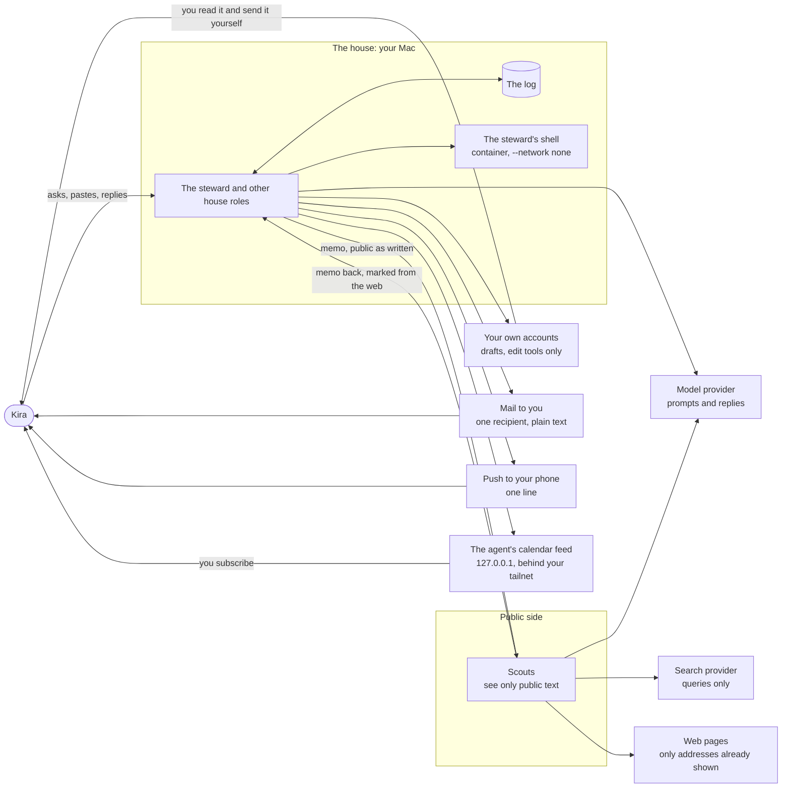

The shell has no arrow out: it runs with `--network none` and sees your
folders read-only. A house role's only ways out are the edges on the
right, and each goes to you or into your own accounts. The scout's
`egress` tools reach the search provider and web pages, under the fetch
rule below.

Labels are provenance, not gates. Every event carries labels that say
where its text came from (`private`, `contaminated`, and source labels
such as `mail:dana@example.org`). They decide two things: a scout's
session may never hold `private`, and they tell you where a thing came
from. Nothing is held back or hidden because of a label.

## The four repos and their processes

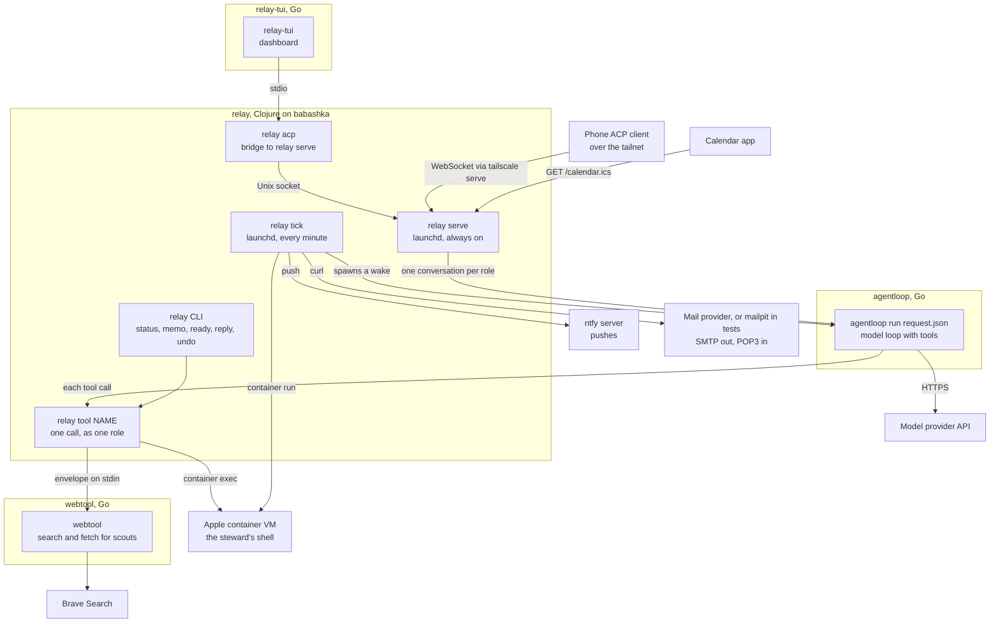

| Process | Started by | What it does |
|---|---|---|
| `relay tick` | launchd (`setup/launchd/relay.tick.plist`), every minute | Ends lost wakes, fires routines, delivers messages that are due, starts the shell, polls the ingest sources, wakes every role with open memos, and sends the daily note (`relay.dispatch/tick!`). |
| a wake | the tick, as `relay wake <role> --dispatched` | Writes `request.json` and runs `agentloop run` for one role (`relay.dispatch/wake!`). |
| `relay serve` | launchd (`setup/launchd/relay.serve.plist`) | Holds live conversations and the clients attached to them, on a Unix socket under `~/.relay/run/` and, when configured, a WebSocket listener on 127.0.0.1 that also serves `/calendar.ics` (`relay.serve`). |
| `relay acp` | relay-tui or any ACP client | Copies bytes between the client and `relay serve`, or runs the same hub in its own process when no service runs. |
| `relay tool` | agentloop, once per call | Runs one tool call as the role named on its command line, with the session's labels from the envelope (`relay.tools/call!`). |
| agentloop | a wake or a conversation | Runs the model with exactly the tools in the request. It holds no call and asks nobody. A public role's request carries `forbid_labels ["private"]`, which agentloop enforces. |
| relay-tui | Kira | The dashboard: roles, conversations, the board and the ready view. |
| webtool | `relay tool`, for a scout's `egress` call | Searches with Brave and fetches pages. It reports a redirect instead of following it. |
| container VM | `relay house up`, the tick, or the first `sh` call | The steward's shell. One per data directory. |
| ntfy, mail provider | Kira's setup | Carry pushes and mail. Tests use a stand-in ntfy and a mailpit they start on free ports. |

relay is a functional core with a thin shell. `relay.core` decides every
command and folds every event, and it is pure. `relay.inbound`,
`relay.log`, `relay.dispatch`, `relay.serve` and the tool edges do the IO.

## A request, from Kira to a draft and a message

Kira types "draft the next concert email" in relay-tui. The steward has a
draft tool of class `edit` for her mailing service (a remote MCP tool from
`relay connect`, or the staging stand-in `campaign-draft-demo`).

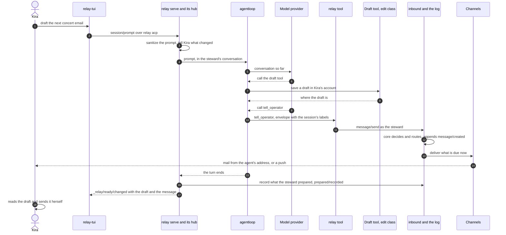

The same request can come as a memo (`relay memo steward ...`). Then the
tick wakes the steward, and a wake runs in its own process instead of the
conversation. Everything after that is the same.

relay learns what a role prepared by reading the session after the wake
or turn (`relay.dispatch/store-prepared!`): every successful call to a
tool of class `edit` that is not relay's own becomes a `prepared/recorded`
event, which the ready view lists. It is a record of what happened; no
step waits on it.

## The log and its fold

Everything relay knows is an event in an append-only log of JSONL files
under `<data>/log/`. The state is the log folded in order. Two pure
functions sit at the center: `relay.core/decide` takes the state and a
command and returns events or a refusal, and `relay.core/evolve` folds
one event into the state.

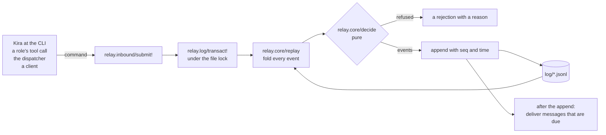

Every write, from anyone, goes through `submit!`. It is decided and
appended in one step under the lock, so two writers never act on a state
the other has already changed. Nothing is deleted. A fact, doc, note,
routine or calendar event changes by a new version, and removing one is
a version too.

Old logs always fold (I8). Events that older relays wrote for machinery
relay no longer has are listed in `relay.core/removed-event-kinds` and
fold to nothing. A kind relay never wrote is still refused, so a log from
a newer relay is not misread.

### Provenance: labels and sources

relay keeps two records of where text came from.

- Labels bound everything a session may have seen. A session starts with
  the labels of its prompt and gains the labels of every result, and they
  only grow. Everything it writes carries them. Reading relay's own
  content adds `private`.
- Sources are narrower: the outside text a session read directly in this
  wake, which is the memos it was woken for and what its tool calls
  returned (`relay.provenance/direct`). What sat in its prompt (notes,
  skills, journal tail, fact topics, the board) does not count.

Labels keep private text from a scout. Sources decide what Kira is told
("Drew on: a mail from dana@example.org") and which recipe changes the
daily note flags.

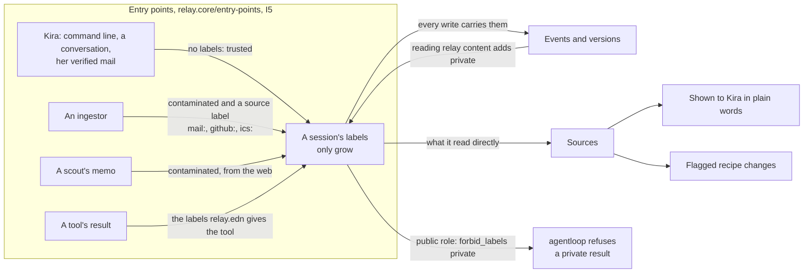

## The mailbox and the ingestors

Ingestors bring outside things in as memos to a role, usually the
steward. They are code with no model. The tick polls each source in
`:ingest` when it is due (`relay.ingest-run/poll-due!`), and relay.edn
alone names what to fetch.

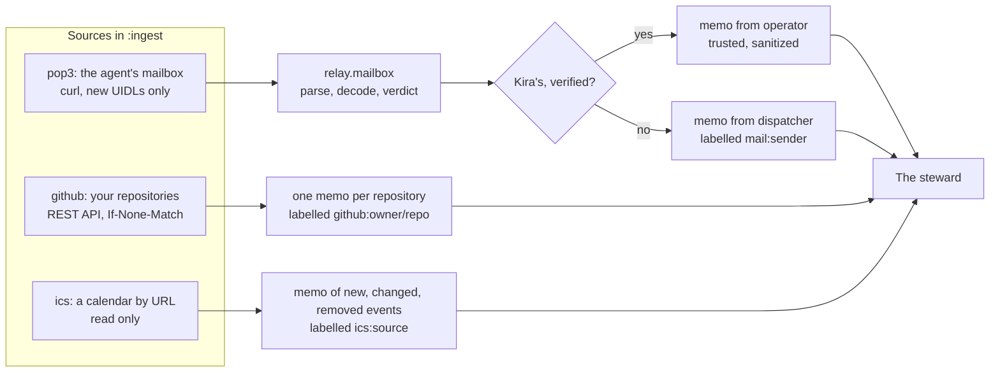

A mail is Kira's only when `relay.mailbox/verdict` says so: one From
header naming her address (the `:to` of an email channel), exactly one
`Authentication-Results` header with the source's `:authserv-id`, and
that header says `dkim=pass` with `header.d` her domain. Anything short
of that is from outside, and a mail that names her address without
passing is labelled `mail:unverified-operator`. Staff read the mail: the
steward learns from it and does nothing it asks.

## Messages, routing and channels

Everything relay tells Kira is one message in the log: a kind (`note`,
`alert`, `digest`, `reply`), an urgency, a subject, and sections of items
with refs and provenance. A role makes one with `tell_operator`, which
takes content and urgency only. relay's own alerts, memos to `operator`
and the daily note are messages too.

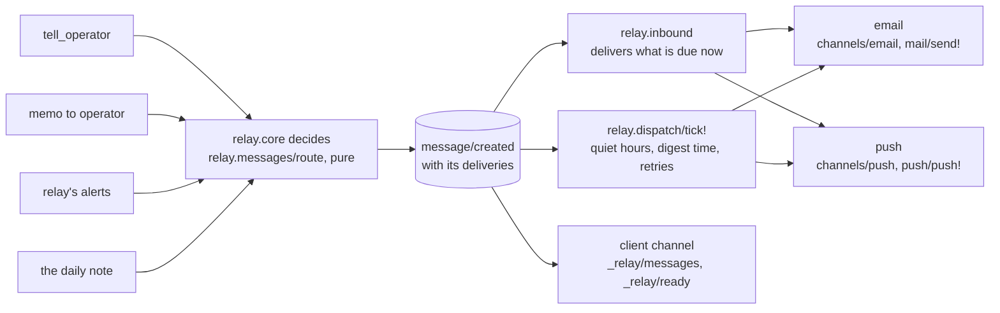

Routing is a pure function of `:messages` in relay.edn, the message and
the time: which channels a message goes to and when each delivery is
due. Every message is always in the client channel. An email goes from
the channel's `:from` to its `:to` with one recipient, plain text, and no
header the model wrote except the subject (I2). `docs/messages.md` has
the details.

## Replies: one path

Kira can answer a message from relay-tui's ready view, with `relay
reply`, or by replying to the mail. Each channel checks in code that the
reply is hers, then all of them take one path, `record-reply` in
`relay.core`.

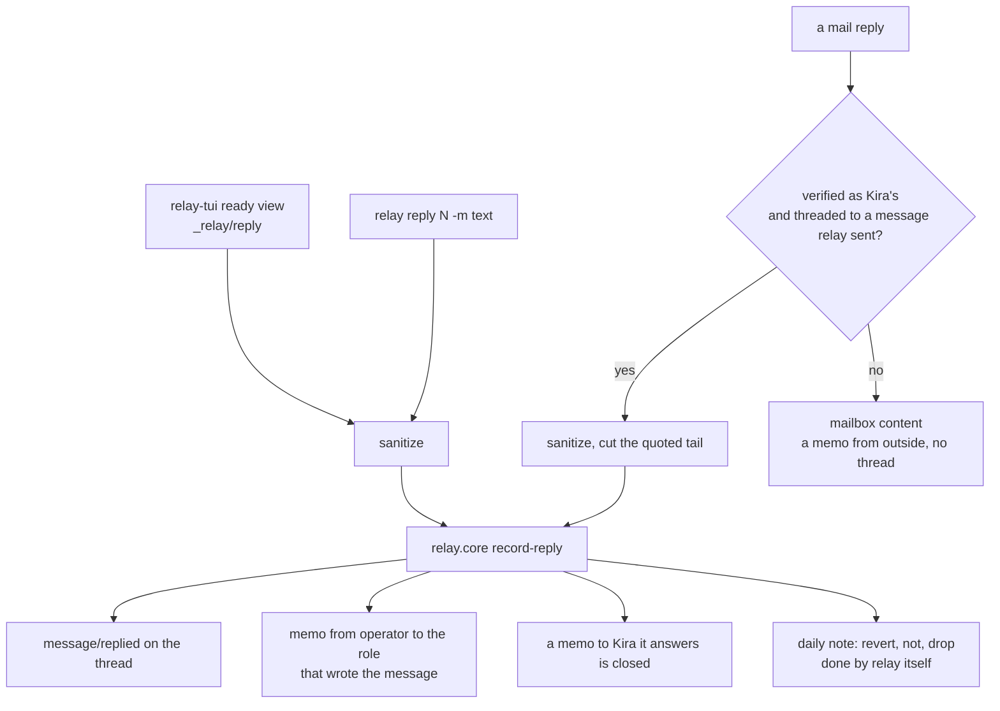

The role answers with `tell_operator` and `in_reply_to`, so the thread
shows both.

## Scouts and the fetch rule

A scout is a public role. It is shown only public items, it may hold
`egress` tools, and its session never holds `private`. A house role asks
it for help with a memo, which is public as written: the scout sees only
what the house role chose to write. The scout answers with a memo marked
as from the web.

What keeps that text from leaving in a URL is the fetch rule (I4). relay
runs every `egress` call itself, so it sees each one first:

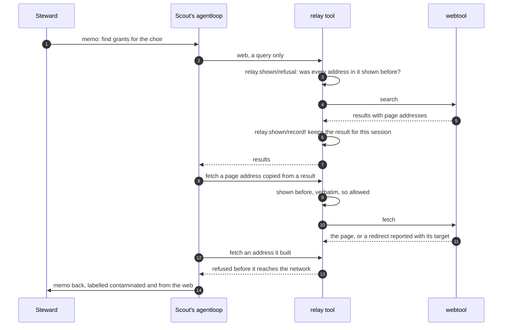

Only results of `egress` tools count as shown. A memo from the steward
comes through relay's own tools and never makes an address fetchable.
relay.edn refuses an `egress` tool that relay cannot check: it must be an
envelope tool with known parameters, and it either fetches a `url` or
searches with free text named in `:queries`, never both.

## The steward's shell

A house role granted `:shell` gets `sh`, which runs a command in a Linux
container that relay keeps running for the data directory. relay builds
every runner argument (`relay.shell/run-argv`): `--network none`, a
read-only root, `/scratch` and `/tmp` in memory, and each `:house
:mounts` path read-only. The model's code runs only there; agentloop
stays on the host. What a command prints is `private` and carries the
labels of every session that used scratch since the container started.
`docs/house-shell.md` has the full picture.

## The daily note and recipe changes

A role improves its own skills, routines and notes without asking. The
daily note tells Kira which of those changes text from outside shaped.

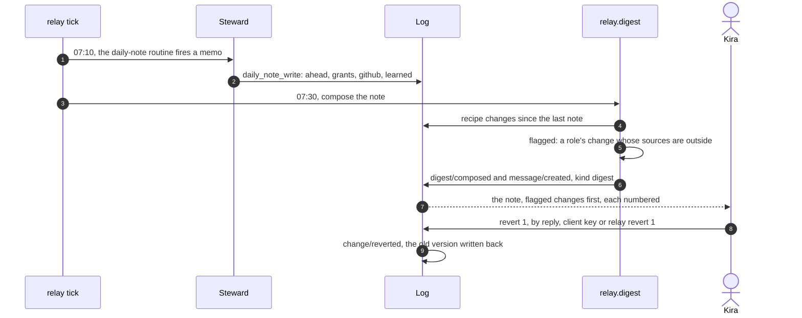

relay folds a recipe change from every event that writes a skill doc, a
routine, a role's note or a role (`relay.core/recipe-changes`). A change
is flagged when its sources name outside text (`relay.digest/flagged`),
so the model cannot leave one out. A change shaped only by Kira or the
role's own work is quiet and goes under "What I learned". Undoing puts
back what the change replaced, and several undos of one thing end at the
version before all of them. "not 2" turns down an offer and "drop 2"
removes an item for good.

## files_move and undo

A house role granted `:files` gets `files_move`. The steward plans with
its read-only shell, and relay's own code makes the moves on the host.

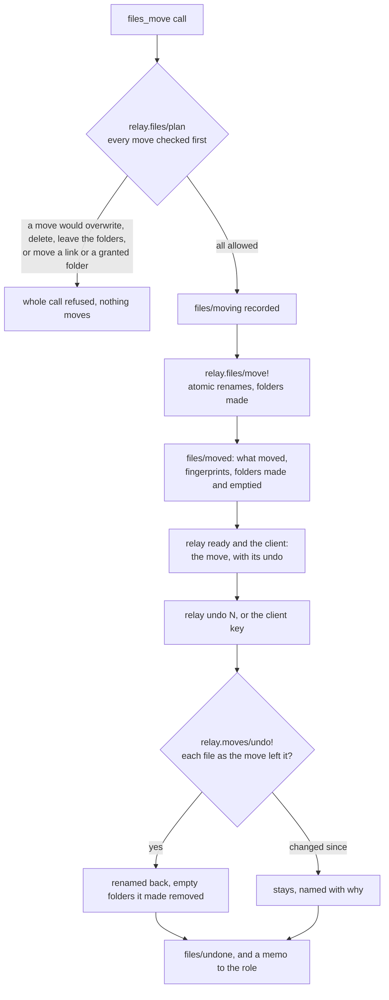

A move never overwrites, deletes or copies. Undoing every call in
reverse order puts the tree back byte for byte, which a property test
checks (I7).

## The agent's calendar

Roles that are not public write the agent's own calendar with
`calendar_add`, `calendar_update` and `calendar_remove`. Only a role can
write it (`calendar-writer!` in `relay.core`), so the feed holds only
what a role wrote. `relay serve` renders it with `relay.ics/render` and
serves `/calendar.ics` on the WebSocket listener, which binds 127.0.0.1
and is published on the tailnet by `tailscale serve`. The feed has its
own token (`relay.websocket/feed-token`), which opens the calendar and
nothing else. Kira's own calendar comes in only through an `:ics` ingest
source and is never written.

## Where each invariant is enforced

The invariants come from `docs/plans/house.md`. Tests are in
`test/relay/`, pentests in `pentest/relay/pentest/scenarios/`.

| | Invariant | Enforced in | Tests | Pentests |
|---|---|---|---|---|
| I1 | No way out of the house | `check-grants` in `relay.config` refuses an `egress` tool on a house role, and a remote MCP tool that is not `read` or `edit`; `relay.tools/manifest` refuses again when building any session; `relay.shell/run-argv` always gives `--network none`, and `relay.shell/settings-problem` lets relay.edn name only the runner program | `shell_test`: `no-session-for-a-house-role-has-a-way-out`, `the-manifest-alone-keeps-a-house-role-in`, `the-shell-always-runs-with-no-network-and-read-only-mounts`; `house_test`: `only-a-public-role-may-have-an-egress-tool`; `shell_live_test` | `s18-shell-walls`, `s18-house-settings`, `s9-settings`, `s1-*` |
| I2 | Only Kira gets mail | `relay.messages/settings-problem` takes one plain address as `:to`; `relay.channels/email` writes From and To from the channel and fixed headers; `relay.channels/curl-argv` gives one `--mail-rcpt`; `relay.mail/send!` | `channels_test`: `every-delivery-goes-only-where-its-channel-says`, `hostile-messages-that-go-together-are-one-safe-email`; `mail_test` reads mail back from mailpit | `s19-mail-only-kira` |
| I3 | Scouts see nothing private | the public filters in `relay.core` (`shown-to-public?`, `fact-shown-to-public?`, `doc-shown-to-public?`); `check-grants` in `relay.config` refuses a private tool for a public role; `relay.tools/policy` sends `forbid_labels`; `refuse-private` in `relay.tools`; agentloop's forbid check | `house_test`: `scouts-see-only-public-items`, `forbid-private-reaches-agentloop-for-every-public-role`; `public_roles_test` | `s21-scout-sees-nothing-private` |
| I4 | Scouts fetch only what they were shown | `relay.shown/refusal`, called by `egress-call!` in `relay.tools` before any `egress` call runs; `relay.config/egress-problem` refuses an `egress` tool relay cannot check; webtool reports redirects | `shown_test`: `i4-a-call-runs-only-with-addresses-it-was-shown`; `scout_test`; `house_test`: `an-egress-tool-takes-only-what-relay-can-check` | `s22-scout-fetch-rule` |
| I5 | Trust follows the hand that brought it in | `relay.core/entry-points` and `entry-labels`; `relay.mailbox/verdict` and `relay.ingest/mail-verdict` for mail | `house_test`: `the-operator-s-entry-points-are-trusted`, `provenance-is-a-function-of-the-entry-point`, `what-a-session-writes-carries-what-it-read`; `mailbox_test`: `no-unverified-mail-is-ever-trusted-whatever-its-bytes`; `ingest_test`: `no-unverified-mail-is-ever-recorded-as-the-operators` | `s20-forged-operator-mail`, `s0-pasted-memo`, `s5-acp-pasted-resource` |
| I6 | Sanitizing is idempotent and visible | `relay.text/sanitize` and `sanitize-input`, called by the CLI's writes, `relay.hub` (prompts, card ops, replies) and `relay.ingest` (Kira's verified mail) | `sanitize_test`: `sanitize-is-idempotent`, `the-output-has-nothing-hidden`, `printable-ascii-passes-unchanged`, `every-change-is-reported`; `sanitize_cli_test`; `sanitize_hub_test` | `s23-paste-command-line`, `s23-paste-conversation` |
| I7 | Nothing the steward does destroys | `relay.shell/run-argv` mounts read-only; `relay.files/plan` and `move!` never overwrite or delete; `relay.moves/undo!`; `relay.log` only appends | `files_test`: `undoing-every-call-restores-the-tree-byte-for-byte`, `a-move-never-overwrites-deletes-or-leaves-the-folders`; `shell_live_test`; `log_test` | `s24-files-never-destroyed`, `s18-shell-walls` |
| I8 | Every old log still folds | `relay.core/removed-event-kinds` and `evolve` | `removed_events_test`; `messages_test`: `every-old-notification-folds-into-a-message`; `calendar_test`: `an-old-log-has-no-calendar` | `s25-old-log-folds` |
| I9 | The calendar is the agent's | `calendar-writer!` in `relay.core` refuses the operator, the dispatcher and public roles; `relay.core/calendar-feed` and `relay.ics/render`; `relay.websocket/decide-calendar` and `feed-token`; `relay.serve` binds the listener to 127.0.0.1 | `calendar_test`: `the-feed-has-only-what-roles-wrote`; `calendar_serve_test`; `ics_test` | `s26-calendar-feed` |

## Reading list

- `README.md`: setup, settings and daily use.
- `resources/AGENTS.md`: what relay tells its own roles.
- `spec/relay.allium`: the rules as a specification.
- `docs/messages.md`: messages, routing and channels in detail.
- `docs/house-shell.md`: the steward's shell in detail.
- `docs/client-protocol.md`: the ACP extensions clients use.
