# How relay works

This page describes the whole system as the code on `main` has it: the
parts, how they connect, and where each rule is enforced. The README says
how to use relay. `docs/messages.md`, `docs/house-shell.md` and
`docs/client-protocol.md` go deeper into three of the parts below.

## The house and its walls

relay is a private house. Inside, the roles read everything relay keeps,
your notes and files and the mail that comes in, and get on with the work
without asking you. Nothing inside waits for an approval. What keeps you
safe is the walls, and relay builds them in code:

- No tool can send, post, publish or pay as you. The tool classes are
  `read`, `write`, `edit` and `egress`, and no class covers an action
  others would see. `edit` changes only your own things, where nobody
  else sees the change and you can undo it: a draft in your account, a
  reminder, the agent's own calendar.
- A house role (any role that is not public) is never given an `egress`
  tool. The steward's shell runs in a container with no network.
- Mail goes only to you, from the agent's own address. Mail to any host
  but this machine is encrypted.
- Scouts, the public roles that search the web, are never shown anything
  private, and they may fetch only an address the web showed them.

This is everything that can leave the house, and how:

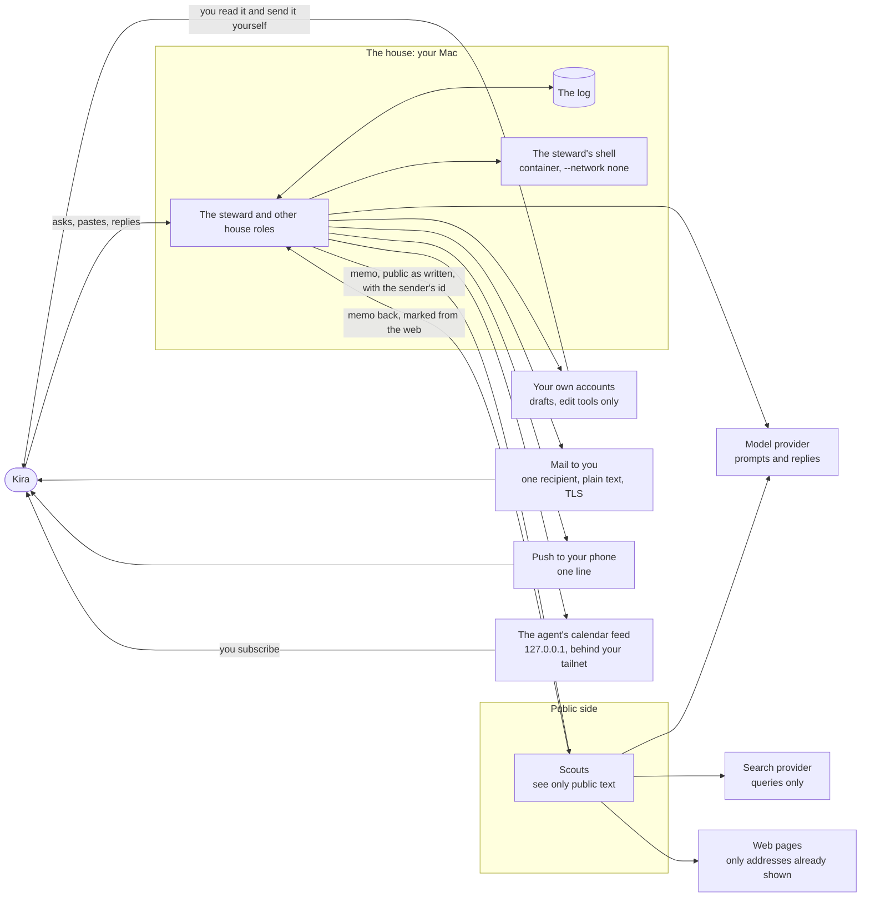

The shell has no arrow out: it runs with `--network none` and sees your
folders read-only. A house role's only ways out are the edges on the
right, and each goes to you or into your own accounts. The scout's
`egress` tools reach the search provider and web pages, under the fetch
rule below.

Labels are provenance, not gates. Every event carries labels that say
where its text came from (`private`, `contaminated`, and source labels
such as `mail:dana@example.org` or `files:downloads`). They decide two
things: a scout's session may never hold `private`, and they tell you
where a thing came from. Nothing is held back or hidden because of a
label. Text whose labels say an outsider may have written it reaches you
with its links broken (`relay.text/for-operator`), in messages, in Ready
and in the calendar feed.

## Trust and provenance at a glance

Trust follows the hand that brought text in. Kira's own words are
trusted. Text from anywhere else carries `contaminated` and a source
label. These are the places text enters, and what relay marks on it:

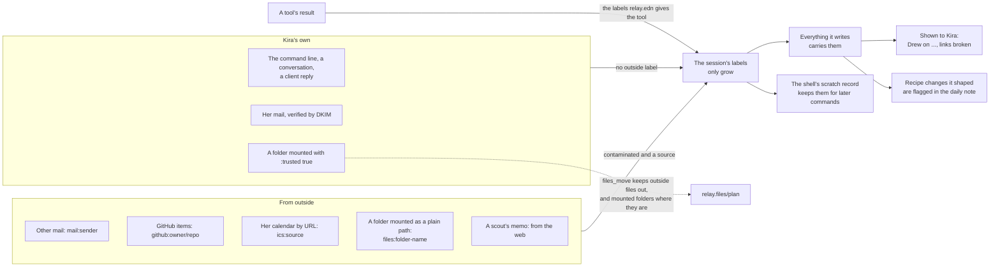

A trusted folder stays Kira's own because nothing relay does can put a
stranger's file in it, or put another folder in its place. The section on
`files_move` below shows how.

## The four repos and their processes

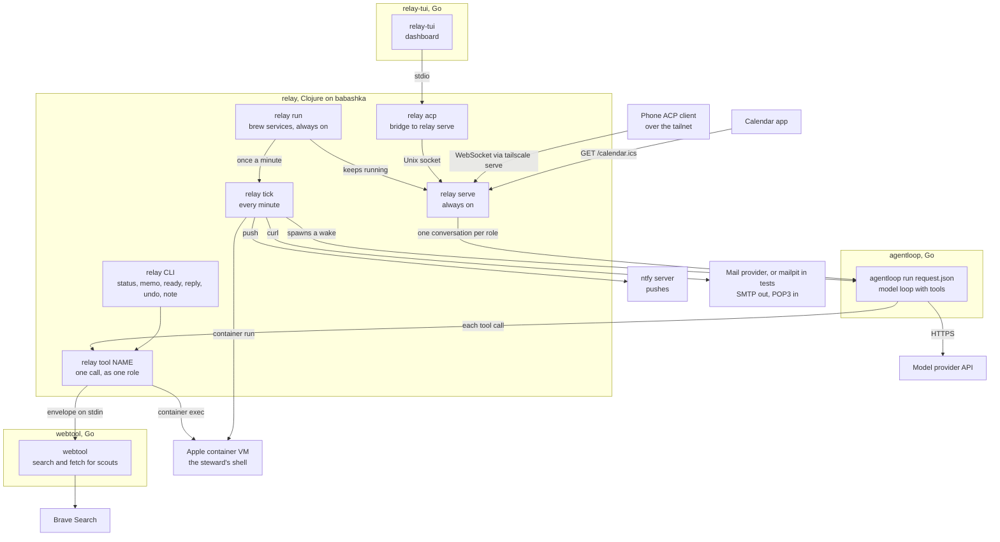

| Process | Started by | What it does |
|---|---|---|
| `relay run` | `brew services start relay` (the formula's service block), always on | Runs `relay serve`, and `relay tick` once a minute, each as a child process (`relay.run`). Ticks never overlap; serve is started again when it exits, at most once a minute. On SIGTERM it stops ticking and waits for serve to end its conversations. |
| `relay tick` | `relay run`, every minute | Ends lost wakes, fires routines, delivers messages that are due, starts the shell, polls the ingest sources, wakes every role with open memos, and sends the daily note (`relay.dispatch/tick!`). It writes `<data>/.last-tick` at most every five minutes, so `relay status` can say when the tick has stopped. |
| a wake | the tick, as `relay wake <role> --dispatched`, in a process group of its own | Writes `request.json` and runs `agentloop run` for one role (`relay.dispatch/wake!`). Its own process group lets it outlive a restart of the service, which launchd ends by killing the service's group (`relay.dispatch/detached`). |
| `relay serve` | `relay run` | Holds live conversations and the clients attached to them, on a Unix socket under `~/.relay/run/` and, when configured, a WebSocket listener on 127.0.0.1 that also serves `/calendar.ics` (`relay.serve`). |
| `relay acp` | relay-tui or any ACP client | Copies bytes between the client and `relay serve`, or runs the same hub in its own process when no service runs. |
| `relay tool` | agentloop, once per call | Runs one tool call as the role named on its command line, with the session's labels from the envelope (`relay.tools/call!`). |
| agentloop | a wake or a conversation | Runs the model with exactly the tools in the request. It holds no call and asks nobody. A public role's request carries `forbid_labels ["private"]`, which agentloop enforces. |
| relay-tui | Kira | The dashboard: roles, conversations, the board and the ready view. It always reopens in moving mode, so the first key acts on the dashboard, and a saved draft waits in the input. Ready counts new items above the selection as "↑ n new". It shows times in the zone relay names in its ready answer, the operator's `:timezone`. |
| webtool | `relay tool`, for a scout's `egress` call | Searches with Brave and fetches pages. It reports a redirect instead of following it. |
| container VM | `relay house up`, the tick, the first `sh` call | The steward's shell. One per data directory. `relay house build` builds its image. |
| ntfy, mail provider | Kira's setup | Carry pushes and mail. Tests use a stand-in ntfy and a mailpit they start on free ports. |

relay is a functional core with a thin shell. `relay.core` decides every
command and folds every event, and it is pure. `relay.inbound`,
`relay.log`, `relay.dispatch`, `relay.serve` and the tool edges do the IO.
`relay run` has the same split: `relay.run/due` and `started` decide
when each child starts, and `run!` starts them.

relay.edn is checked in one pass (`relay.config/validate`). `relay
status` and the tick's alert list every problem at once, numbered, each
with its fix.

## A request, from Kira to a draft and a message

Kira types "draft the next concert email" in relay-tui. The steward has a
draft tool of class `edit` for her mailing service (a remote MCP tool from
`relay connect`, or the staging stand-in `campaign-draft-demo`).

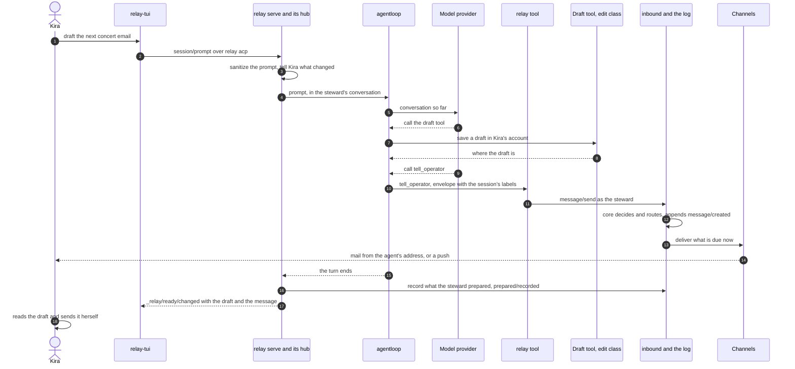

The same request can come as a memo (`relay memo steward ...`). Then the
tick wakes the steward, and a wake runs in its own process instead of the
conversation. When the steward closes Kira's memo, what it wrote as the
outcome reaches her as a quiet reply, "Re: <subject>" (origin
`request-done`, in `decide* :memo/close`). That reply is not sent when
the steward already told her about the memo with `tell_operator` and its
`memo` argument, when the memo was her reply to a message, or when a
public role closes it.

relay learns what a role prepared by reading the session after the wake
or turn (`relay.dispatch/store-prepared!`): every successful call to a
tool of class `edit` that is not relay's own becomes a `prepared/recorded`
event, which the ready view lists. It is a record of what happened; no
step waits on it.

## The log and its fold

Everything relay knows is an event in an append-only log of JSONL files
under `<data>/log/`. The state is the log folded in order. Two pure
functions sit at the center: `relay.core/decide` takes the state and a
command and returns events or a refusal, and `relay.core/evolve` folds
one event into the state.

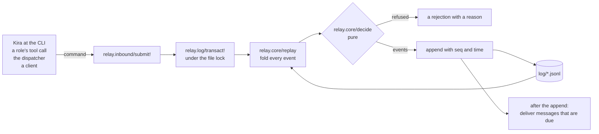

Every write, from anyone, goes through `submit!`. It is decided and
appended in one step under the lock, so two writers never act on a state
the other has already changed. Nothing is deleted. A fact, doc, note,
routine or calendar event changes by a new version, and removing one is
a version too.

Old logs always fold (I8). Events that older relays wrote for machinery
relay no longer has are listed in `relay.core/removed-event-kinds` and
fold to nothing. An old `notification/created` folds into the message it
would be now, marked `:legacy` and resolved. It is history: it is not in
Ready, and a reply to it is refused. A kind relay never wrote is still
refused, so a log from a newer relay is not misread.

### Provenance: labels and sources

relay keeps two records of where text came from.

- Labels bound everything a session may have seen. A session starts with
  the labels of its prompt and gains the labels of every result, and they
  only grow. Everything it writes carries them. Reading relay's own
  content adds `private`.
- Sources are narrower: the outside text a session read directly in this
  wake, which is the memos it was woken for and what its tool calls
  returned (`relay.provenance/direct`). What sat in its prompt (notes,
  skills, journal tail, fact topics, the board) does not count. A shell
  result names one source per untrusted folder mounted. An outside tool
  whose labels say only `contaminated` is named as `tool:<name>`.

Labels keep private text from a scout. Sources decide what Kira is told
("Drew on: a mail from dana@example.org", "Drew on: your files in
downloads") and which recipe changes the daily note flags.

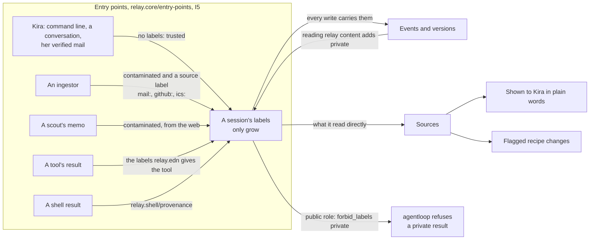

## The mailbox and the ingestors

Ingestors bring outside things in as memos to a role, usually the
steward. They are code with no model. The tick polls each source in
`:ingest` when it is due (`relay.ingest-run/poll-due!`), and relay.edn
alone names what to fetch.

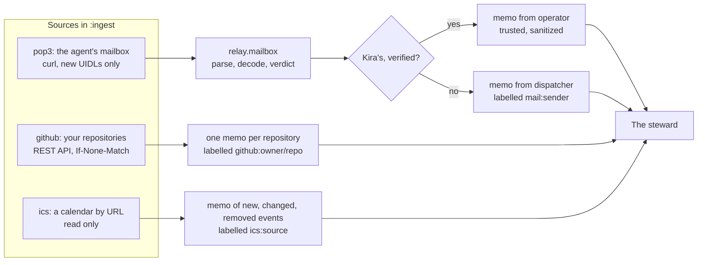

A mail is Kira's only when `relay.mailbox/verdict` says so: one From
header naming her address (the `:to` of an email channel), exactly one
`Authentication-Results` header with the source's `:authserv-id`, and
that header says `dkim=pass` with `header.d` her domain. Anything short
of that is from outside, and a mail that names her address without
passing is labelled `mail:unverified-operator`. Staff read the mail: the
steward learns from it and does nothing it asks.

A GitHub source with `:github-login` leaves Kira's own items out. When
relay.edn has a daily note, new GitHub items wait for it instead of
being pushed.

## Messages, routing and channels

Everything relay tells Kira is one message in the log: a kind (`note`,
`alert`, `digest`, `reply`), an urgency, a subject, and sections of items
with refs and provenance. A role makes one with `tell_operator`, which
takes content and urgency, and `memo` when it answers one of Kira's
memos. relay's own alerts, memos to `operator`, the outcomes of her
requests and the daily note are messages too.

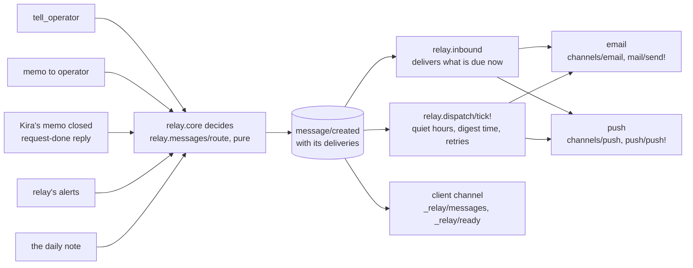

Routing is a pure function of `:messages` in relay.edn, the message and
the time: which channels a message goes to and when each delivery is
due. Every message is always in the client channel. An email goes from
the channel's `:from` to its `:to` with one recipient, plain text, and no
header the model wrote except the subject (I2). An email channel's `:url`
is `smtps://`, or `smtp://` with STARTTLS required: curl runs with
`--ssl-reqd` (`relay.channels/curl-argv`). Unencrypted `smtp://` is
allowed only to localhost, 127.0.0.1 and `[::1]`
(`relay.messages/plain-smtp?`). `docs/messages.md` has the details.

## Replies: one path

Kira can answer a message from relay-tui's ready view, with `relay
reply`, or by replying to the mail. Each channel checks in code that the
reply is hers, then all of them take one path, `record-reply` in
`relay.core`.

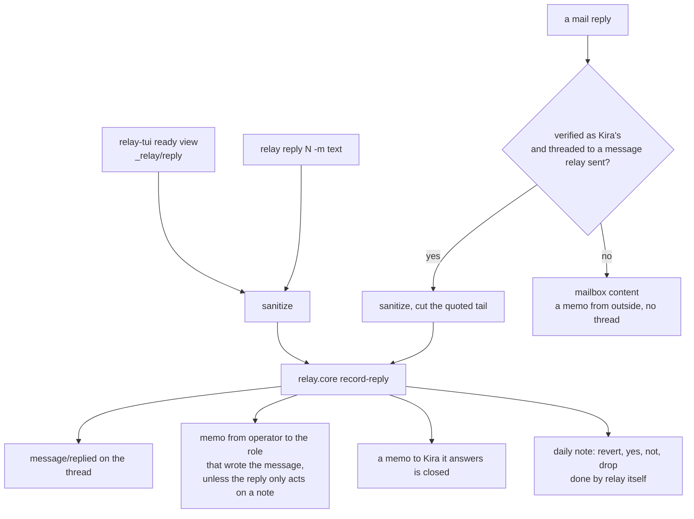

A reply to a `:legacy` message is refused. The role answers with
`tell_operator` and `in_reply_to`, so the thread shows both.

## Scouts and the fetch rule

A scout is a public role. It is shown only public items, it may hold
`egress` tools, and its session never holds `private`. A house role asks
it for help with a memo, which is public as written: the scout sees what
the house role chose to write, and the sender's id so it can answer. It
is shown nothing else of that role, not its title or its instructions.
The scout answers with a memo marked as from the web.

What keeps that text from leaving in a URL is the fetch rule (I4). relay
runs every `egress` call itself, so it sees each one first:

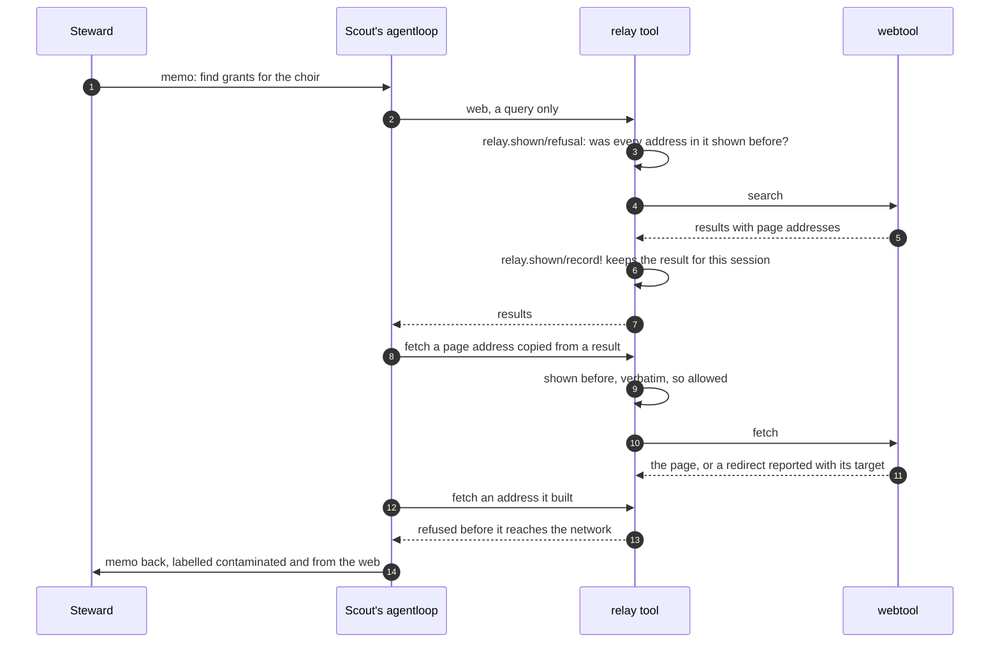

Only results of `egress` tools count as shown. A memo from the steward
comes through relay's own tools and never makes an address fetchable.
relay.edn refuses an `egress` tool that relay cannot check: it must be an
envelope tool with known parameters, and it either fetches a `url` or
searches with free text named in `:queries`, never both.

## The steward's shell

A house role granted `:shell` gets `sh`, which runs a command in a Linux
container that relay keeps running for the data directory. relay builds
every runner argument (`relay.shell/run-argv`): `--network none`, a
read-only root, `/scratch` and `/tmp` in memory, and each `:house
:mounts` folder read-only at its own path. The model's code runs only
there; agentloop stays on the host. `docs/house-shell.md` has the full
picture.

A mount is a path, or `{:path "..." :trusted true}`. A plain path is
untrusted, because a folder of downloads, cloned repositories or saved
mail can hold a stranger's text. relay cannot tell which files a command
read, so it labels every result by what is mounted
(`relay.shell/provenance`, pure):

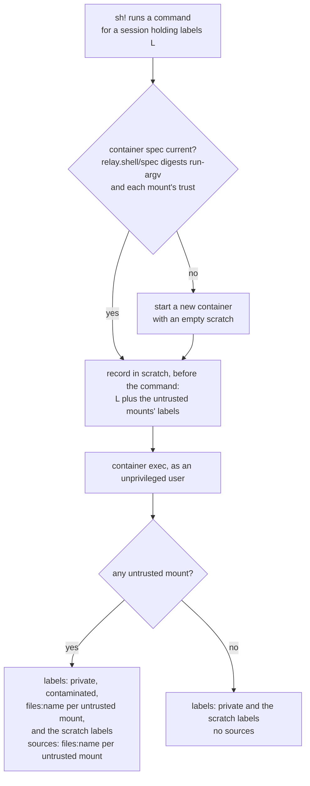

- The source label is `files:` and the folder's last path segment in
  lower case, with other characters as hyphens (`relay.shell/mount-label`).
  Kira reads it as "your files in downloads".
- Scratch is not a source of its own. Every command records its session's
  labels and the untrusted mounts' labels in the scratch record before it
  runs, so a file copied into scratch keeps them, whatever relay.edn says
  of the folder later.
- Trust is part of the container's spec. Marking a folder trusted
  replaces the container and empties its scratch.
- `relay house status` marks trusted folders "(trusted)". `relay status`
  says when `:house` and a `:shell` grant are set and the image is
  missing.

## The daily note and recipe changes

A role improves its own skills, routines and notes without asking. The
daily note tells Kira which of those changes text from outside shaped,
and lists items she can act on.

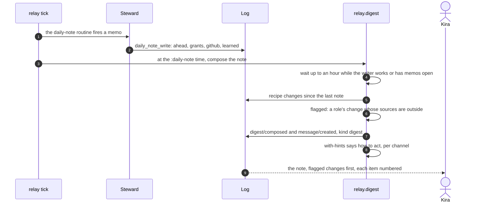

relay folds a recipe change from every event that writes a skill doc, a
routine, a role's note or a role (`relay.core/recipe-changes`). A change
is flagged when its sources name outside text (`relay.digest/flagged`),
so the model cannot leave one out. A change shaped only by Kira or the
role's own work is quiet and goes under "What I learned".

The note's text holds no channel's wording. `relay.digest/with-hints`
adds it where the note is read: reply words in mail when relay reads
replies (`relay.ingest/reads-replies?`, a pop3 source with
`:authserv-id`), commands at the command line, and nothing in a push or
in the client, which shows its own keys.

### Acting on an item

Kira can do four things with a numbered item, from three places. All of
them reach `act-on-note` in `relay.core`:

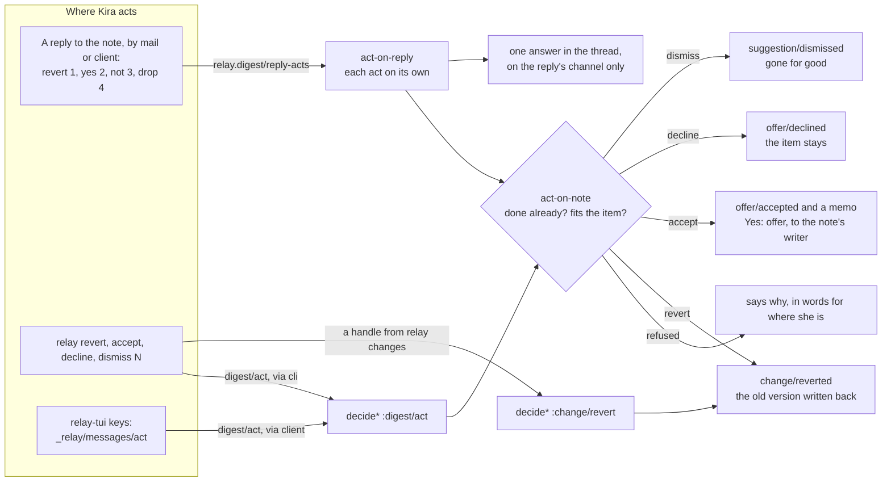

- A reply that only acts ("revert 1", "not 2") goes to no role
  (`relay.digest/only-acts?`), since relay has done all it asks. Its
  answer is resolved when nothing was refused, and stays in Ready when
  something was.
- A refusal names the fix where Kira is (`act-sentence`): a command at the
  command line, plain words in the client, a reply word in a reply. An
  item already done says so first.
- Accepting wakes the note's writer with a memo from Kira. The memo asks
  it to do what it offered and record the result with `offer_outcome`.
- Undoing puts back what the change replaced, and several undos of one
  thing end at the version before all of them. Adding or removing a role
  is never undone.

## files_move and undo

A house role granted `:files` gets `files_move`. The steward plans with
its read-only shell, and relay's own code makes the moves on the host.

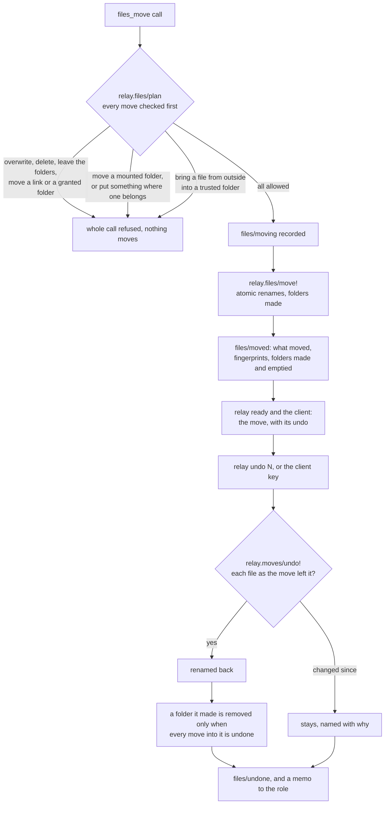

A move never overwrites, deletes or copies. Undoing every call in
reverse order puts the tree back byte for byte, which a property test
checks (I7). A partly undone move reads "N of M still moved (K put
back)". A refusal caused by a later move names that move.

### Moves around the shell's folders

The running container binds each mounted folder, not its path, while
trust is attached to the path. So `relay.files/plan` takes every mount
(`relay.files/mount-places`) and checks three things for each move:

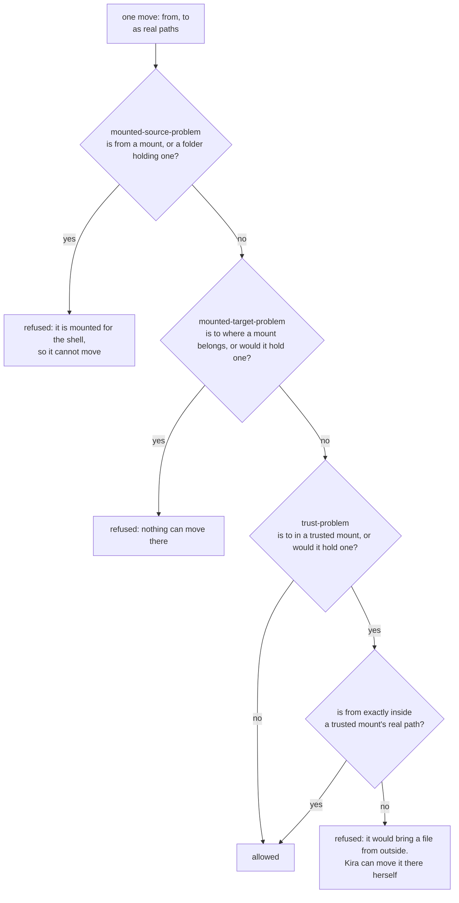

- Paths are compared the way the disk compares them: firmlinks removed,
  NFC, lower case. Each mount is checked in every form: as written, its
  real path, and for a mount that does not exist yet, the real path it
  would have. The edge also checks file identity, so another name for a
  mounted folder is caught.
- A source counts as inside a trusted folder only by its exact real path,
  so any doubt refuses the move. The session's labels play no part.
- Moves within a trusted folder, out of one, between two trusted folders,
  and between untrusted places go ahead. Undo is Kira's, and can put a
  file back into the trusted folder it came from.
- The `files_move` description names the mounted and trusted folders, so
  the steward knows the rules before it tries a move.

So a trusted folder's files change only by Kira's hand or by moves within
trusted folders.

## The agent's calendar

Roles that are not public write the agent's own calendar with
`calendar_add`, `calendar_update` and `calendar_remove`. Only a role can
write it (`calendar-writer!` in `relay.core`), so the feed holds only
what a role wrote. `relay serve` renders it with `relay.ics/render` and
serves `/calendar.ics` on the WebSocket listener, which binds 127.0.0.1
and is published on the tailnet by `tailscale serve`. The feed has its
own token (`relay.websocket/feed-token`), which opens the calendar and
nothing else. Kira's own calendar comes in only through an `:ics` ingest
source and is never written.

`relay.core/calendar-feed` carries each event's labels. When they hold
`contaminated` or a source label, `relay.ics/field-text` strips hidden
characters and then breaks every link in the title, location and
description, so a stranger's link is never live in Kira's calendar app.
`relay calendar url` prints the address, then probes the feed once. It
says when `relay serve` is not running, when something else holds the
port, or when the tailnet address is not published.

## Installing and upgrading

relay, agentloop, relay-tui and webtool are formulas in Kira's tap
(github.com/kirahowe/homebrew-tap). They build from `main` for now, with
no releases. relay's formula installs `bin`, `src`, `resources` and
`setup` under its keg's `libexec`, with a bb.edn of its own that names
only the paths, and depends on the other three, so installing relay
installs them. Its service block runs `relay run`, with the data
directory from `~/.config/relay/config.edn`.

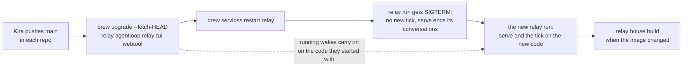

There is no pause and no rollback: an upgrade only swaps the keg, and
the log is forward-only (decision 22 in `docs/plans/house.md`). A wake
that starts during the upgrade runs whichever keg `/opt/homebrew/opt/relay`
points to when it starts. relay records the path it was run by
(`/opt/homebrew/bin/relay`), not the keg's, wherever it writes one down,
so nothing it saved names a keg an upgrade removes.

## Where each invariant is enforced

The invariants come from `docs/plans/house.md`. Tests are in
`test/relay/`, pentests in `pentest/relay/pentest/scenarios/`.

| | Invariant | Enforced in | Tests | Pentests |
|---|---|---|---|---|
| I1 | No way out of the house | `check-grants` in `relay.config` refuses an `egress` tool on a house role, and a remote MCP tool that is not `read` or `edit`; `relay.tools/manifest` refuses again when building any session; `relay.shell/run-argv` always gives `--network none`, and `relay.shell/settings-problem` lets relay.edn name only the runner program | `shell_test`: `no-session-for-a-house-role-has-a-way-out`, `the-manifest-alone-keeps-a-house-role-in`, `the-shell-always-runs-with-no-network-and-read-only-mounts`; `house_test`: `only-a-public-role-may-have-an-egress-tool`; `shell_live_test` | `s18-shell-walls`, `s18-house-settings`, `s9-settings`, `s1-*` |
| I2 | Only Kira gets mail | `relay.messages/settings-problem` takes one plain address as `:to`, and an `:url` that is encrypted unless it goes to this machine (`plain-smtp?`); `relay.channels/email` writes From and To from the channel and fixed headers; `relay.channels/curl-argv` gives one `--mail-rcpt`, and `--ssl-reqd` for any other host; `relay.mail/send!` | `channels_test`: `every-delivery-goes-only-where-its-channel-says`, `hostile-messages-that-go-together-are-one-safe-email`, `smtp-to-another-host-requires-starttls`; `mail_test` reads mail back from mailpit | `s19-mail-only-kira` |
| I3 | Scouts see nothing private | the public filters in `relay.core` (`shown-to-public?`, `fact-shown-to-public?`, `doc-shown-to-public?`); `decide* :memo/send` in `relay.core` sends a house role's memo to a scout public as written, with only the sender's id; `check-grants` in `relay.config` refuses a private tool for a public role; `relay.tools/policy` sends `forbid_labels`; `refuse-private` in `relay.tools`; agentloop's forbid check | `house_test`: `scouts-see-only-public-items`, `forbid-private-reaches-agentloop-for-every-public-role`, `a-house-role-s-request-to-a-scout-goes-as-written`; `public_roles_test`: `a-memo-from-the-house-to-a-public-role-is-public-as-written` | `s21-scout-sees-nothing-private` |
| I4 | Scouts fetch only what they were shown | `relay.shown/refusal`, called by `egress-call!` in `relay.tools` before any `egress` call runs; `relay.config/egress-problem` refuses an `egress` tool relay cannot check; webtool reports redirects | `shown_test`: `i4-a-call-runs-only-with-addresses-it-was-shown`; `scout_test`; `house_test`: `an-egress-tool-takes-only-what-relay-can-check` | `s22-scout-fetch-rule` |
| I5 | Trust follows the hand that brought it in | `relay.core/entry-points` and `entry-labels`; `relay.mailbox/verdict` and `relay.ingest/mail-verdict` for mail; for the shell, `relay.shell/provenance`, `relay.shell/spec` and the scratch record in `relay.shell/sh!`; `relay.files/plan` with `trust-problem`, `mounted-source-problem` and `mounted-target-problem`, which keep a trusted folder Kira's own; `relay.ics/field-text` breaks outside links in the feed | `house_test`: `the-operator-s-entry-points-are-trusted`, `provenance-is-a-function-of-the-entry-point`, `what-a-session-writes-carries-what-it-read`; `mailbox_test`: `no-unverified-mail-is-ever-trusted-whatever-its-bytes`; `ingest_test`: `no-unverified-mail-is-ever-recorded-as-the-operators`; `shell_test`: `a-result-is-outside-text-exactly-when-an-untrusted-folder-is-mounted`, `what-an-untrusted-folder-shaped-is-flagged-and-its-links-broken`, `scratch-holds-what-an-untrusted-folder-could-have-put-there`, `trust-is-part-of-the-container-spec`; `files_test`: `nothing-from-outside-ever-lands-in-a-trusted-folder`, `no-sequence-of-moves-changes-what-a-trusted-mount-shows`, `a-mounted-folder-stays-the-folder-the-shell-was-given`; `ics_test`: `an-outside-events-text-holds-no-live-link-and-a-clean-ones-is-unchanged` | `s20-forged-operator-mail`, `s0-pasted-memo`, `s5-acp-pasted-resource`, `s18-shell-walls`, `s24-files-never-destroyed`, `s26-calendar-feed` |
| I6 | Sanitizing is idempotent and visible | `relay.text/sanitize` and `sanitize-input`, called by the CLI's writes, `relay.hub` (prompts, card ops, replies) and `relay.ingest` (Kira's verified mail) | `sanitize_test`: `sanitize-is-idempotent`, `the-output-has-nothing-hidden`, `printable-ascii-passes-unchanged`, `every-change-is-reported`; `sanitize_cli_test`; `sanitize_hub_test` | `s23-paste-command-line`, `s23-paste-conversation` |
| I7 | Nothing the steward does destroys | `relay.shell/run-argv` mounts read-only; `relay.files/plan` and `move!` never overwrite or delete; `relay.moves/undo!`; `relay.log` only appends | `files_test`: `undoing-every-call-restores-the-tree-byte-for-byte`, `a-move-never-overwrites-deletes-or-leaves-the-folders`; `shell_live_test`; `log_test` | `s24-files-never-destroyed`, `s18-shell-walls` |
| I8 | Every old log still folds | `relay.core/removed-event-kinds` and `evolve`; an old `notification/created` folds as `:legacy` history | `removed_events_test`; `messages_test`: `every-old-notification-folds-into-a-message`; `calendar_test`: `an-old-log-has-no-calendar` | `s25-old-log-folds` |
| I9 | The calendar is the agent's | `calendar-writer!` in `relay.core` refuses the operator, the dispatcher and public roles; `relay.core/calendar-feed` and `relay.ics/render`; `relay.websocket/decide-calendar` and `feed-token`; `relay.serve` binds the listener to 127.0.0.1 | `calendar_test`: `the-feed-has-only-what-roles-wrote`; `calendar_serve_test`; `ics_test` | `s26-calendar-feed` |

## Reading list

- `README.md`: setup, settings and daily use.
- `resources/AGENTS.md`: what relay tells its own roles.
- `spec/relay.allium`: the rules as a specification.
- `docs/messages.md`: messages, routing and channels in detail.
- `docs/house-shell.md`: the steward's shell in detail.
- `docs/client-protocol.md`: the ACP extensions clients use.
