# How relay works

This is the picture of the whole system: what the parts are, how they
connect, and where the rules are enforced. It describes the house
design in `docs/plans/house.md`. Where a part is built, the text says how
it works. Where it is planned and not built yet, the diagram marks it
dashed and the text says which phase brings it.

Written as of phase B5 (the agent's calendar). Phase B13 rewrites this
page for the finished system.

## The idea in one picture

relay is a private house. Inside, the agent works freely: nothing is
held, approved or quarantined. Safety comes from the walls. The walls
are three: the agent holds no credential that can act as Kira, the
steward's shell has no network, and the only things that leave the house
go into Kira's own accounts or to Kira.

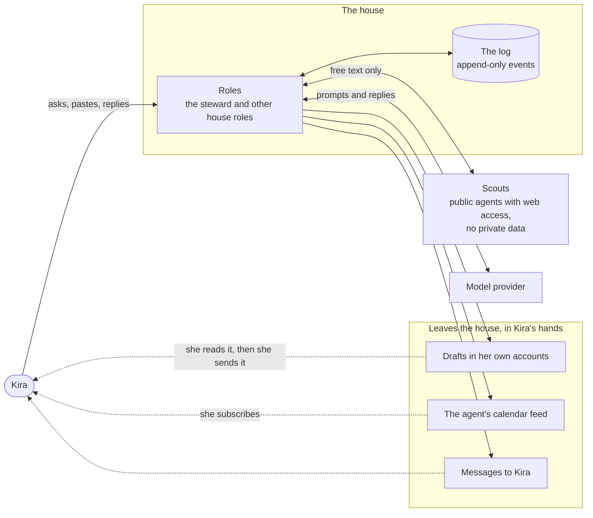

Three rules hold the walls up:

1. **Never as Kira.** No tool can send, post, publish or pay as her.
   The class `act` does not exist. What the agent does outside relay
   is class `edit`: something only Kira sees and she can undo.
2. **No way out.** A house role is granted no `egress` tool. The
   steward's shell runs with `--network none`.
3. **Provenance, not gates.** Everything carries labels saying where it
   came from. Labels are shown to Kira as plain words ("from a mail by
   stranger@example.com"). Nothing is withheld because of one, except
   that a scout can never be shown anything private.

## The four repos

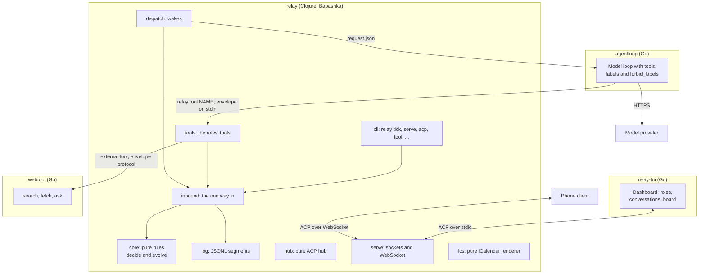

| Repo | What it is | Knows about |
|---|---|---|
| relay | The rules, the log, the tools, the dispatcher, the hub and the service. | Everything below. |
| agentloop | Runs a model in a loop with tools. Checks every call against the tools it was given and the labels policy. Never holds a call. | Nothing about Kira or roles. |
| relay-tui | The terminal dashboard. Speaks ACP, so any ACP agent works as a plain chat. | Nothing about the log. |
| webtool | Search, fetch and ask for public roles. Treats every URL as hostile. | Only its envelope protocol. |

## The log and its fold

Everything relay knows is an event in an append-only log. The state is
the log folded in order, so it can always be rebuilt and nothing is
deleted. The two functions at the center are pure:

- `decide state command ctx` returns events, or refuses.
- `evolve state event` folds one event into the state.

Every change, from anyone, is a command submitted through
`relay.inbound`. It is decided against the current state and appended in
one step under the log's file lock, so two writers can never act on a
state one of them has already changed.

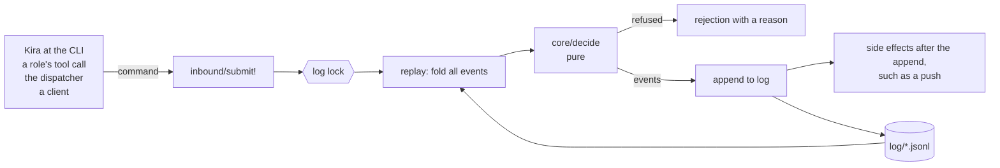

Old logs always fold (I8). A removed feature's events stay in the log
and fold to nothing, listed in `core/removed-event-kinds`.

### Versioned things

Facts, docs and now calendar events share one pattern: every change is
a new version recorded at a time, with the labels of what its writer had
seen. Removing something is also a version, so asking what relay knew
before still gives the old answer.

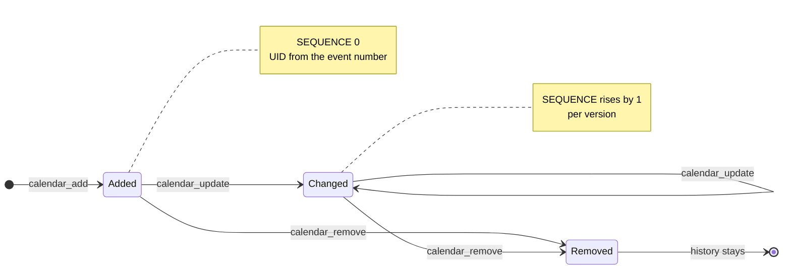

## A wake: how a role does work

Nothing runs between ticks. launchd runs `relay tick` once a minute. It
brings the log up to date with the clock, fires routines that are due,
and wakes every role with an open memo, each in its own process.

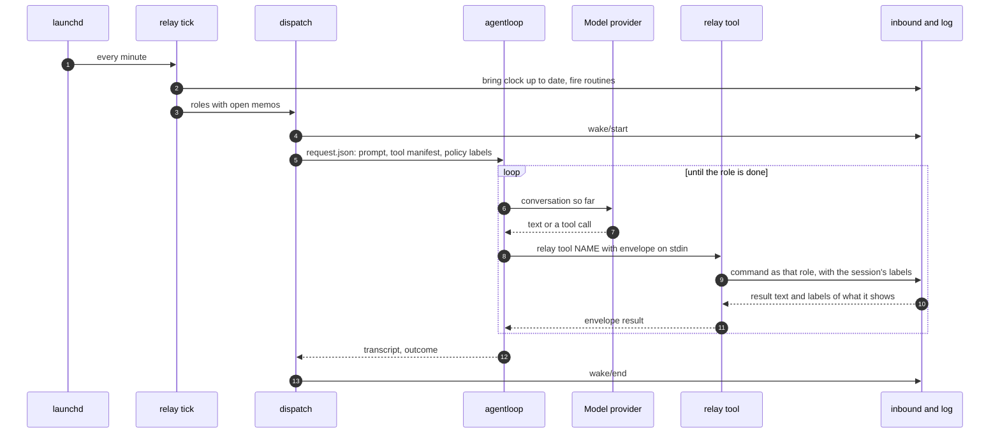

The tools a role is offered depend on its grants in `relay.edn`. A call
to a tool the role was not offered is refused, whatever the harness let
through. A role on a `:script` harness gets no tools at all.

## Conversations: Kira talking to a role

`relay serve` keeps conversations going while no client is attached.
Clients speak ACP to it: relay-tui over a Unix socket, a phone client
over WebSocket. The hub is pure. `relay.serve` is the imperative shell
around it, with one loop thread that owns the hub.

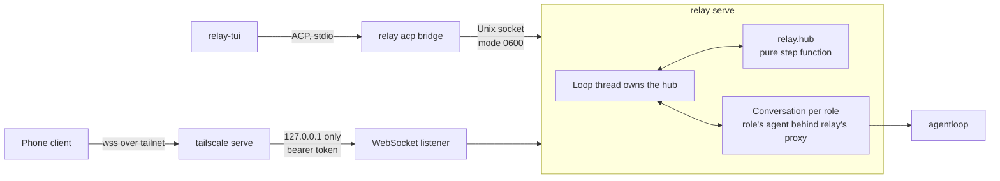

## The calendar (phase B5)

The agent has a calendar of its own, which Kira subscribes to in her
calendar app. It is the whole of the agent's presence on a calendar.
relay never writes hers.

### What writes it, and what cannot

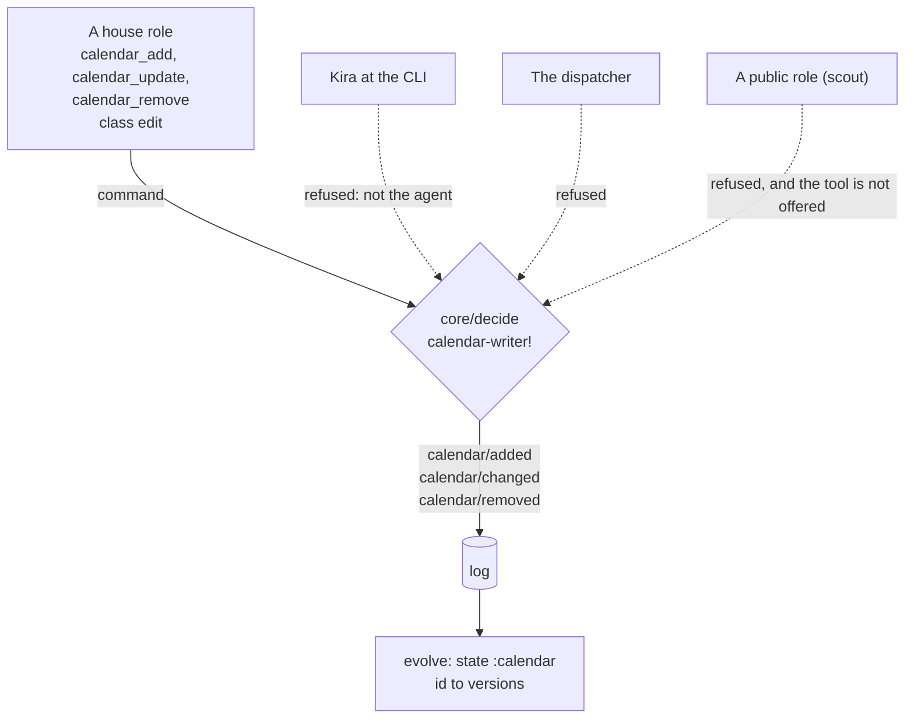

That is invariant I9 on the writing side: the feed holds only events a
role wrote. Reading Kira's own calendar (phase B8) will arrive as memos
from an ingestor. It never becomes calendar events.

### From a tool call to Kira's calendar app

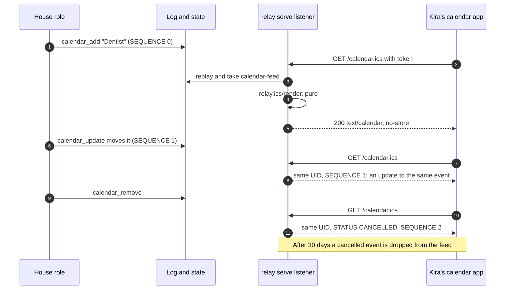

### The renderer

`relay.ics` takes data and returns text. It does no I/O and reads no
clock except the `now` it is given. Properties it keeps, each tested
against a parser written separately in the tests:

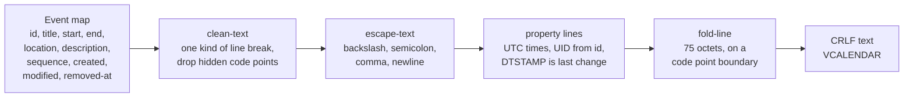

| Property | How it is kept |
|---|---|
| Text cannot add a property or an event | Line breaks become `\n`; control, format, bidi and invisible code points are dropped; `\`, `;`, `,` are escaped. |
| Lines fit | Every physical line is at most 75 octets, the leading space of a continuation included, and a break never falls inside a UTF-8 sequence. |
| UTC | `DTSTART`, `DTEND`, `DTSTAMP`, `CREATED` and `LAST-MODIFIED` are all `...Z`, to the second. |
| Stable UID | `relay-event-<id>@relay.invalid`, from the number of the event that added it. |
| SEQUENCE rises | It is the number of versions minus one, so each change adds one. |
| Same input, same bytes | `DTSTAMP` is the event's last change, not the request time, and events are sorted by id. |
| Removed events | `STATUS:CANCELLED` for 30 days, then dropped. A live event is dropped 30 days after it ends. At most 1000 events are listed, removed ones included. A subscriber that polls less often than that would miss the removal, but the feed does not grow forever. |

### Where it is served

The feed is a second path on the existing WebSocket listener. There is
no new listener and no new address.

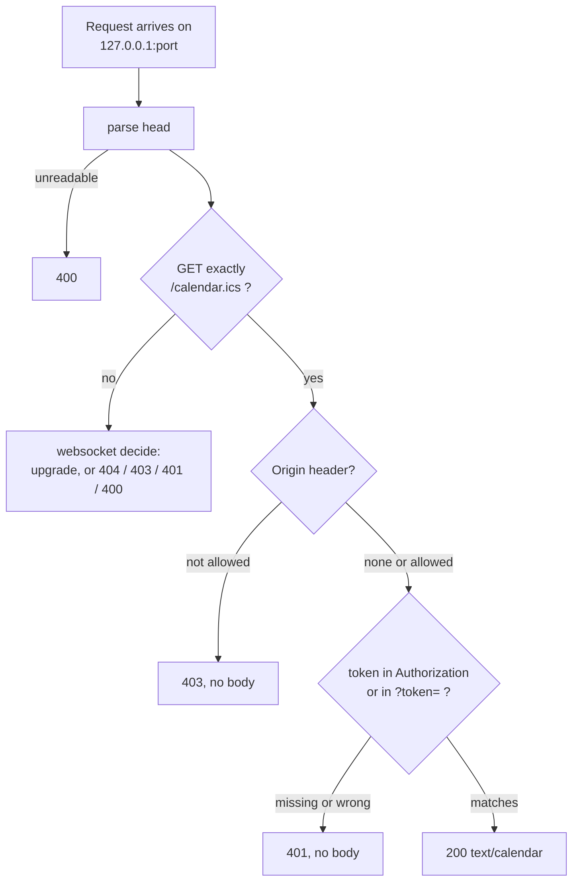

The listener binds `127.0.0.1` only. Tailscale publishes it on the
tailnet with TLS, as for the phone client. So the feed is reachable only
where that listener is, and only with the token it already uses. A
calendar app cannot send a header, so the token may also ride in the
URL. The comparison is constant-time, and a wrong token gets the same
bare answer as no token.

## Provenance: labels

Labels are provenance. They are carried on every event and version and
by every session. Two matter: `private` (read relay content) and
`contaminated` (something an outsider could have written).

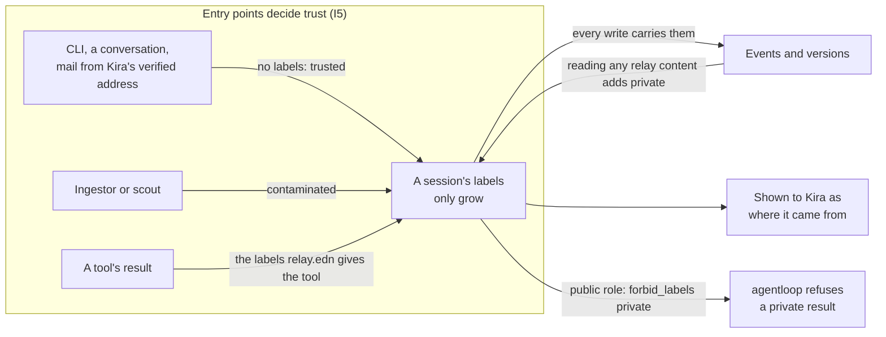

What labels no longer do: hold, quarantine or withhold anything. They
decide two things only: what a scout may be shown, and what provenance
Kira sees.

## Public roles and scouts

A public role never holds private data. It may have `egress` tools such
as web search. Four layers keep private out:

1. relay shows it only public items (`facts`, `docs`, notes and so on).
2. `relay.edn` refuses any grant of a tool whose output is private.
3. Its session starts with `forbid_labels ["private"]`, enforced by
   agentloop: a result carrying private never reaches the model.
4. relay itself replaces any result that carries private with a
   refusal and tells Kira which tool.

Public roles have no calendar and no board: `calendar`, `cards` and the
other private-only tools are not offered to them.

## Where each invariant is enforced

| | Invariant | Enforced in | Tested in |
|---|---|---|---|
| I1 | No way out of the house | `config` refuses egress on a house role | `house_test` (steward shell and remote MCP arrive in B3) |
| I3 | Scouts see nothing private | `core` item filters, `tools/policy`, agentloop `forbid_labels` | `house_test`, `public_roles_test`, `labels_test` |
| I5 | Trust follows the hand that brought it in | `core/entry-labels` | `house_test` |
| I7 | Nothing the steward does destroys | The log is append-only; tools only add versions | `log_test`, `knowledge_test` |
| I8 | Every old log still folds | `core/removed-event-kinds` | `removed_events_test` |
| I9 | The calendar is the agent's | `core/calendar-writer!` refuses the operator, dispatcher and public roles; the feed is rendered from `:calendar` state only; served only by `serve/websocket-connection!` behind the listener's token | `calendar_test`, `calendar_serve_test`, `ics_test` |

## Planned parts

These are in the house plan and not built yet. Each box will be a
separate phase.

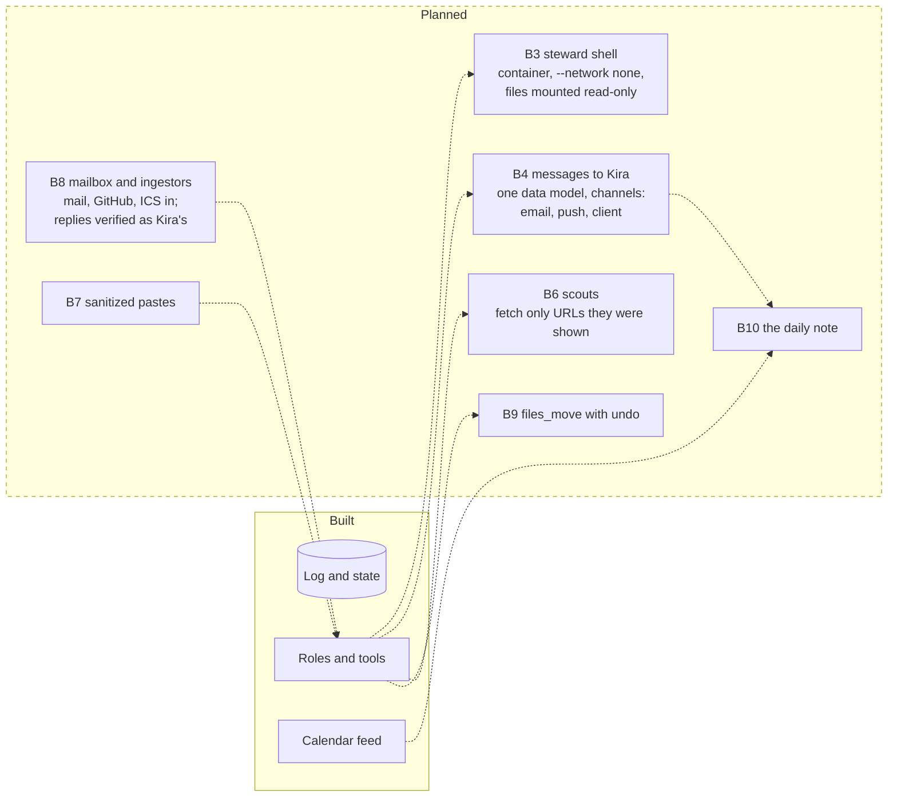

The only mail that leaves the house goes to Kira's configured address,
as text only, with no header the model chose except the subject (I2).
Scouts may fetch a URL only if it appeared verbatim in an earlier tool
result of the same session (I4). Both arrive with the phases above.

## Reading list

- `README.md`: using relay, the tools, setup and deploy.
- `resources/AGENTS.md`: what relay tells its own roles.
- `spec/relay.allium`: the rules, as a specification.
- `docs/client-protocol.md`: the ACP extensions clients use.
- `docs/plans/house.md`: the plan this design comes from.
