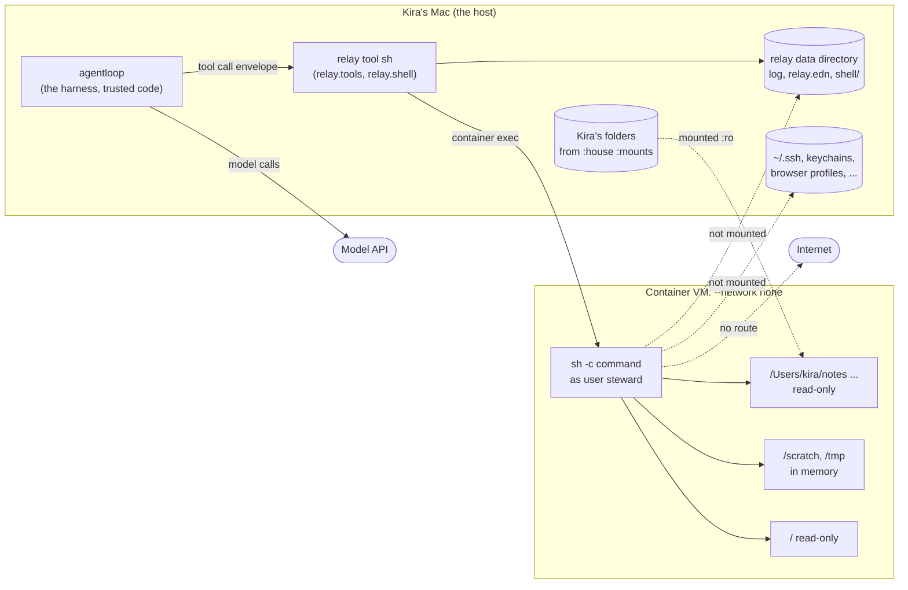
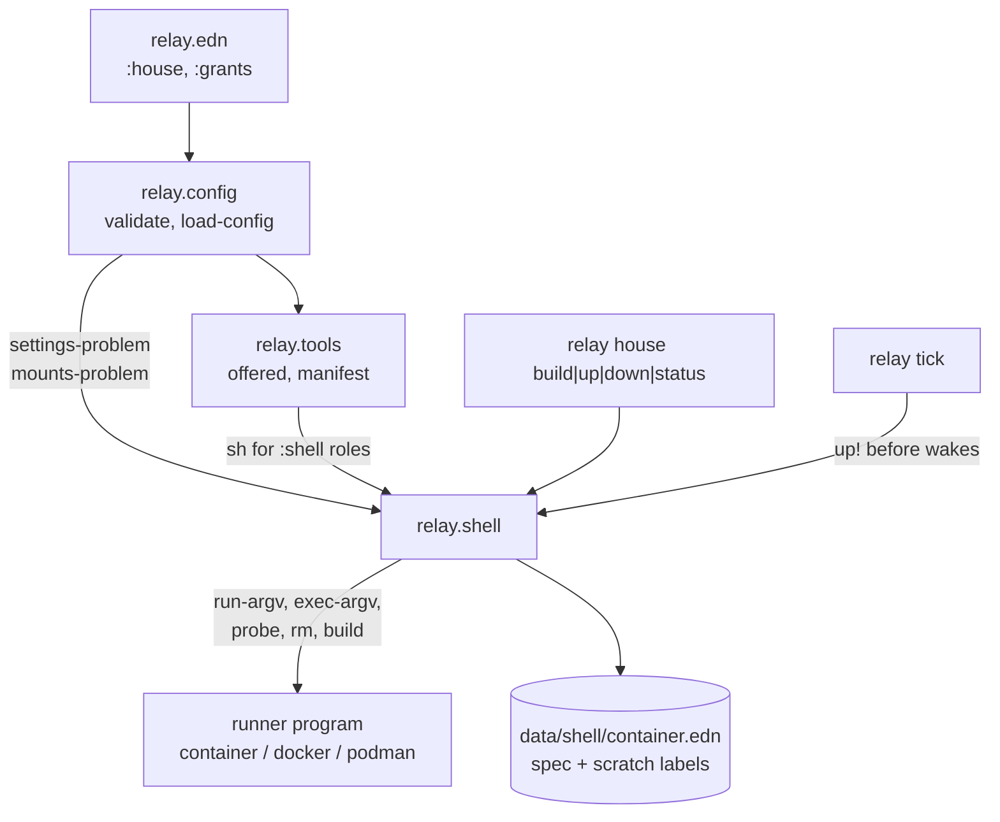
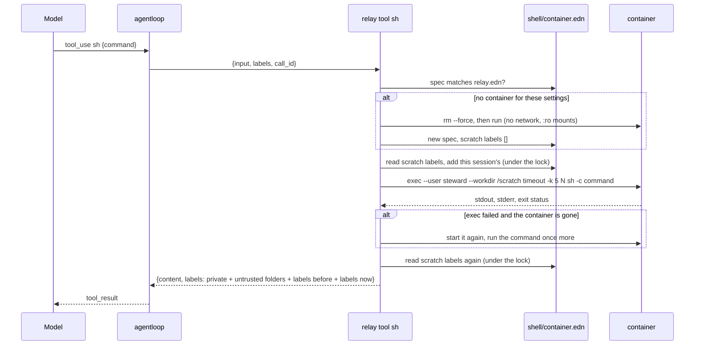
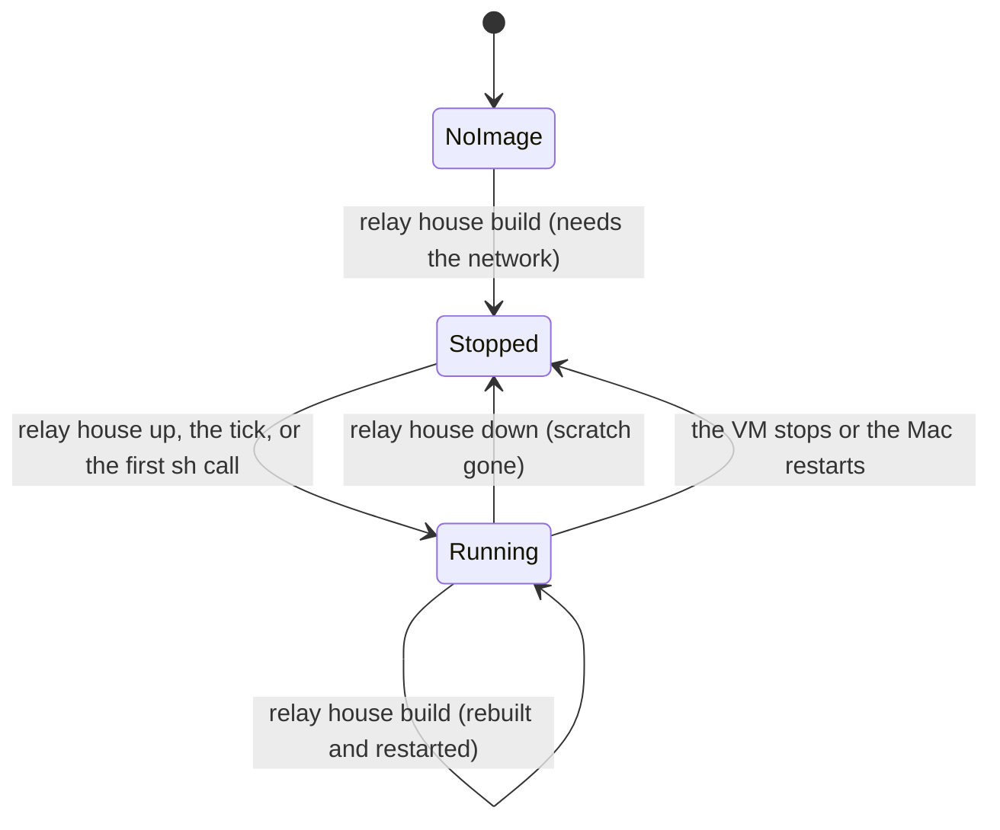
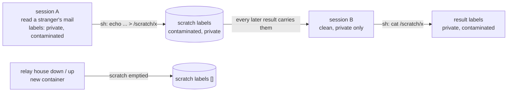

# The steward's shell

This is how the steward's shell works: what it is for, its parts, how a
command gets from the model into the container and back, and where each
guarantee is kept. B13 folds it into `docs/architecture.md`.

## What it is for

The steward needs to read and sort through Kira's files: grep a folder of
notes, pull the text out of a PDF, count rows in a spreadsheet export,
plan how a pile of notes should be filed. It should be able to do that
with ordinary Unix tools, without a tool written for each job, and
without any way for what it runs to send her files anywhere or change
them.

So the model gets one tool, `sh`. Each call runs a command in a Linux
container that has no network, sees Kira's chosen folders read-only and
has one writable directory in memory. The output goes straight back to
the steward as the tool's result. No second model reads it and no schema
shapes it.

## The house and its walls



The model's own code runs only inside the container. agentloop, which
talks to the model API, stays on the host; it is trusted code, and its
only network use in a house session is the model API (plan O3). relay
refuses to give a house role any `egress` tool, so the shell is the one
place the model's code runs, and that place has no network.

## The parts

| Part | Where | What it does |
|---|---|---|
| `:house` in relay.edn | the data directory | Names the runner program, the folders to mount, the image and limits. Nothing else. |
| `:shell true` grant | relay.edn `:grants` | Offers `sh` to a house role. Refused for a public role, without `:house`, or on a script harness. |
| `relay.shell` | `src/relay/shell.clj` | Pure: checks settings and mounts, derives names, composes every runner argument, formats results. Edges: runs the runner, keeps `shell/container.edn` and its lock. |
| `sh` tool | `relay.tools/shell-tool` | A built-in of class `read` with ACP kind `execute`. Its description lists the mounts, the tools and the limits. |
| Containerfile | `resources/house/Containerfile` | Alpine 3.20 with coreutils, find, grep, rg, awk, sed, python3, sqlite3, jq, pdftotext, file, tar, zip, unzip, and a user `steward` (uid 1000). |
| `relay house` | `relay.cli` | `build`, `up`, `down`, `status` for Kira. |
| The tick | `relay.dispatch/tick!` | Starts the shell when it is missing or `:house` changed, before any wake. |



## A command, from the model to the container and back



The time limit is kept inside the VM by `timeout`, because ending the
`container exec` client on the host does not end what it started inside.
relay also waits at most 30 seconds past the limit for the client, and
tells the model the shell did not answer if it is still running then.
Each of stdout and stderr is cut at `:output-limit` bytes, and the
result says so.

## The container's life



relay keeps one container per data directory. Its name and its image's
name come from the SHA-256 of the data directory's real path
(`relay-shell-<12 hex>`), so two data directories, or two test runs,
never share one. relay records a digest of the full `run` argument
vector in `<data>/shell/container.edn`; when relay.edn's `:house`
changes, the digest no longer matches and the next `up` replaces the
container. A change to the time or output limit changes nothing about
how the container runs, so it does not restart it.

## Where provenance comes from



What a command prints shows Kira's files, so it is `private`. A mount
may hold a stranger's text (a download, a cloned repository), so each is
outside text unless relay.edn marks it `{:path ... :trusted true}`. relay
cannot tell which files a command read, so while any untrusted folder is
mounted, every result is also `contaminated` and names each such folder
as its source (`files:<name>`, shown to Kira as "your files in <name>").
With only trusted mounts a result has no source. `/scratch`
outlives a session, so relay records each session's labels before it runs
a command, and every result carries all the labels recorded since the
container started. Session B above was clean, but it reads what session A
left, so Kira is shown that text as from outside, and a recipe change B
makes from it is flagged (decision 14). The record lives on the host, in
the data directory, where nothing in the container can reach it. It is
emptied only when relay starts a new container, whose scratch is empty
too.

Two sessions can use the shell at the same time, such as a tick wake and
a live conversation. A command that is still running when another session
writes to scratch may read what it wrote, so relay reads the record twice:
once when the command starts and again, under the same lock, when it
ends. The result carries both. Every writer records its labels before its
command runs, so the second read sees every session that could have
written to scratch while the command ran.

```mermaid
sequenceDiagram
  participant B as clean session B
  participant S as scratch labels
  participant D as session D (read a stranger's mail)
  B->>S: record [private], read [] before
  Note over B: sleep 2; cat x (running)
  D->>S: record [contaminated, private]
  D->>D: echo ... > x
  Note over B: cat x prints D's text
  B->>S: read again: [contaminated, private]
  Note over B: result labels: contaminated, private
```

## Where each guarantee is kept

| Guarantee | Kept by | Checked by |
|---|---|---|
| I1: the shell has no network | `run-argv` always gives `--network none`; relay.edn names only the runner program, and one naming a network is refused | property `the-shell-always-runs-with-no-network-and-read-only-mounts`; live test and pentest `s18-shell-walls` try TCP, UDP, DNS, vsock to the host and unix sockets |
| I1: no session for a house role has a way out | config refuses `egress`, a remote MCP tool that is not `read` or `edit`, and `:shell` for a public role; `tools/manifest` refuses again | property `no-session-for-a-house-role-has-a-way-out` over generated relay.edn; property `the-manifest-alone-keeps-a-house-role-in` over the same settings without relay.edn's checks |
| I7: Kira's files cannot be changed | every mount ends in `:ro`; the root is read-only; commands run as an unprivileged user | live test writes, removes, moves and creates files in a mount and finds them unchanged |
| No secret is mounted | `mount-problem`: never the data directory, home, relay's settings or the workbench's list of secret places, with a `/System/Volumes/Data` prefix (a macOS firmlink) checked as the path it stands for; checked again on real paths when the container starts, and by file identity (`identity-problem`) | property `a-mount-that-passes-shows-no-secret`; firmlink cases in `secrets-are-never-mounted`; tests of a symbolic link and a firmlink to the data directory |
| Provenance survives scratch | `record-session!` before each command; the scratch labels read again when it ends; `result-labels` | tests `what-one-session-leaves-in-scratch-carries-its-labels` and `a-command-reads-scratch-as-carrying-what-was-written-while-it-ran` |
| Tests never collide | names from the SHA-256 of the data directory's whole real path; tests remove exactly their own container and image by name | property `names-come-from-the-data-directory` over paths with different parents |

## Running it

```sh
container system start          # once, on macOS
relay house build               # builds relay-shell-<id>:latest, needs the network
relay house up                  # or let the tick start it
relay house status              # and which folders it sees
relay house down                # removes it, and /scratch with it
relay house remove              # removes it and relay's image, leaving nothing behind
```

On Linux, set `:runner ["docker"]` or `["podman"]`; relay uses the same
verbs (`run`, `exec`, `rm --force`, `image inspect`, `image rm`, `build`)
with each.
