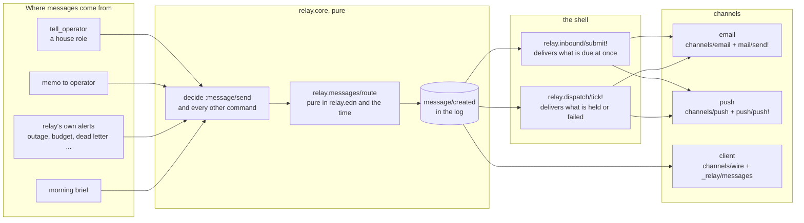
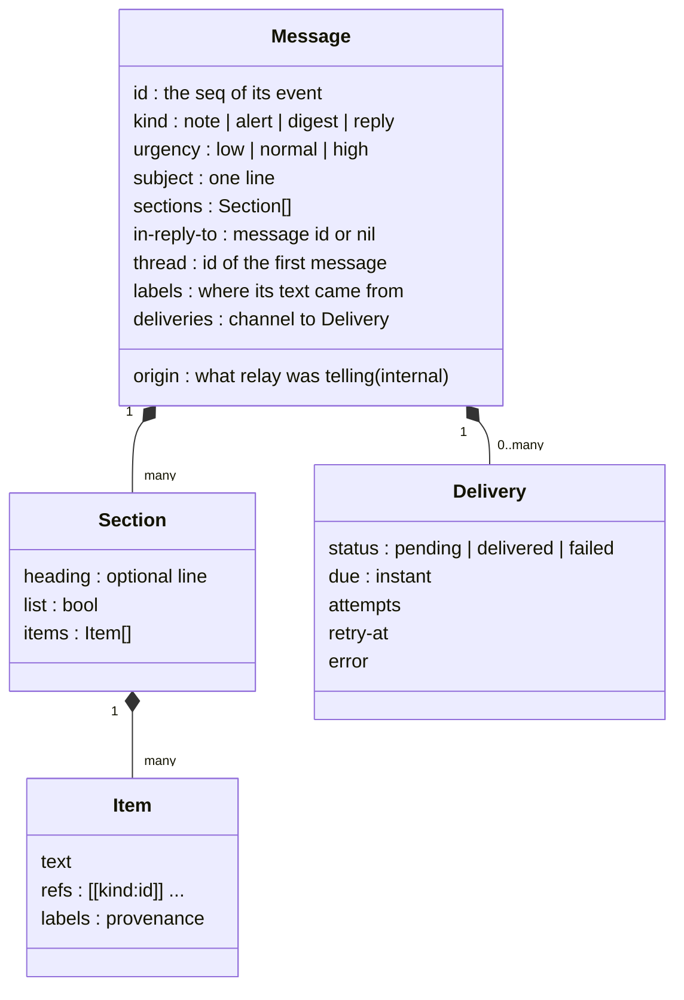
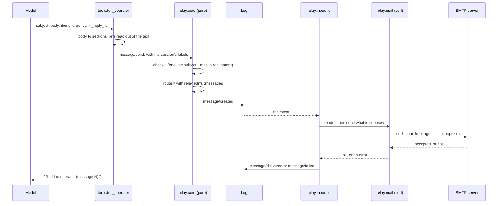
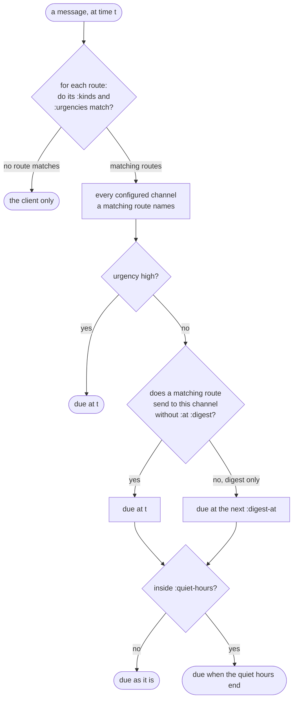
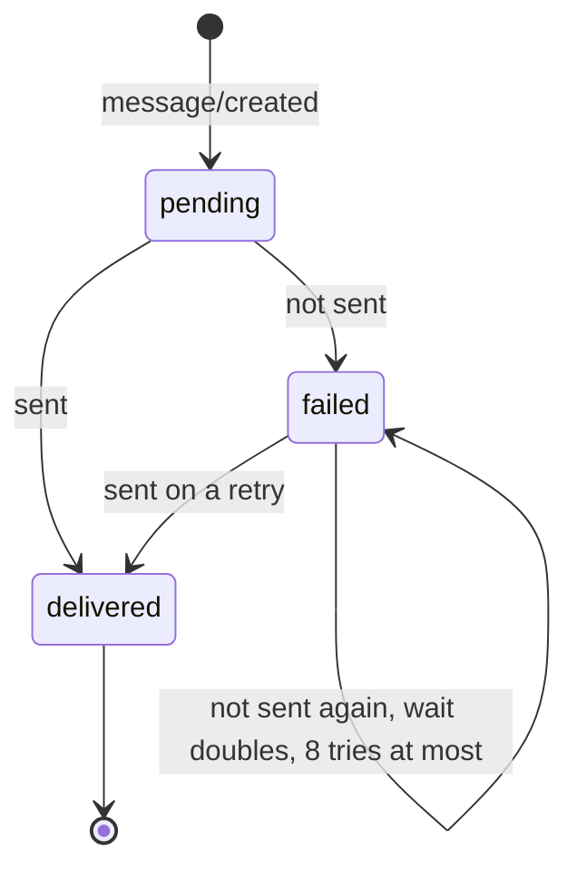
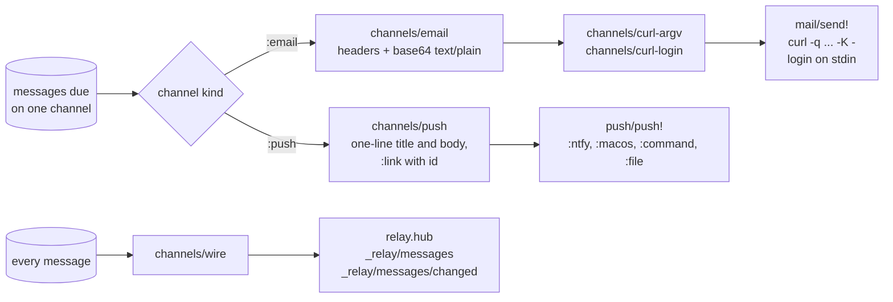
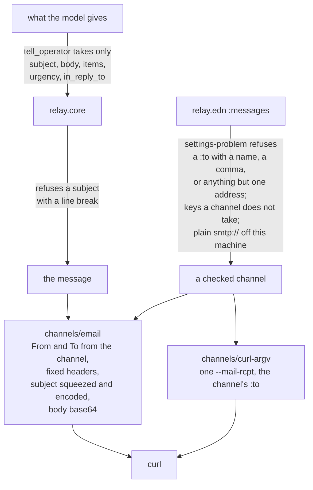

# Messages to Kira

Everything relay tells the operator is a message. A message is one piece
of data in the log, and the same message can reach the operator's phone,
her mail and the client. This page describes how that works: the data
model, where a message comes from, how relay.edn routes it, how each
channel renders and delivers it, and where I2 ("only Kira gets mail") is
enforced. The code is in `src/relay/messages.clj` (the model and
routing), `src/relay/channels.clj` (the renderers), `src/relay/push.clj`
and `src/relay/mail.clj` (the delivery edges), and `relay.core`,
`relay.inbound`, `relay.dispatch` and `relay.hub` (the wiring).

## The pieces

Decisions happen in `relay.core`, which is pure: a command comes in, and
events come out. A message is decided and routed there, in the same
transaction as whatever caused it, and written to the log as one
`message/created` event. Delivery happens afterwards, in the shell. The
log, not the delivery, is the record. A failed delivery loses nothing:
the message is in the log and in the client either way.

## The data model

- `kind` says what the message is. A role's message is a `note`, or a
  `reply` when it answers one. relay's own problems are `alert`s. The
  morning brief is a `digest`.
- `urgency` is the role's to choose (`normal` when it gives none).
  relay's own alerts set theirs in code.
- An item's `labels` are its provenance. The operator never sees a
  label's name: text from outside is shown with `[from outside]` and its
  links broken, in every channel.
- `origin` (`told`, `memo-for-operator`, `harness-unreachable` and so
  on) is relay's own record of what it was telling, so it can tell the
  operator once. No channel sends it.

## A role tells the operator

`tell_operator` is a relay tool of class `edit`. It is offered only to
house roles. A public role reports back by memo instead.

The model gives content and urgency, nothing else. It cannot name a
channel, an address or a recipient, and nothing it writes reaches a mail
header except the subject.

tell_operator is held to limits: a subject of at most 200 characters,
at most 12 sections of at most 50 items, and at most 4000 characters an
item. A message over a limit is refused, and the model is told which.
relay's own messages quote memos, what a model service said and error
text, none of which has a limit, so relay cuts those to fit instead. A
long item ends in an ellipsis, and a long list ends with "…and 11 more."
Refusing them would undo the change that tells the operator, and a tick
that cannot record its change stops relay.

## Routing

`relay.messages/route` is a pure function of relay.edn's `:messages`,
the zone, the message and the time. It returns the configured channels
the message goes to, each with when it is due.

The route is worked out once, when the message is made, and recorded in
the event. A later change to relay.edn does not reroute old messages.
The client is not a route: every message is always the client's.

## Delivery and its lifecycle

Two places deliver:

- `relay.inbound/submit!` delivers, right after the append, every
  delivery that is due the moment its message was made.
- `relay.dispatch/tick!` delivers the rest: deliveries held for quiet
  hours or the digest that have come due, deliveries a process recorded
  but stopped before making (pending for over two minutes), and failed
  ones whose retry is due. It groups what is due on one channel at the
  same tick into one push or one email, so the end of the quiet hours
  brings one push, not ten.

A channel that has gone from relay.edn fails for good, without retries.

## The channels

Each channel is a pure renderer and a thin delivery edge.

### Email

- From the channel's `:from` (the agent's own address) to its `:to`
  (Kira's address), and no one else.
- Headers, in this order: `From`, `To`, `Subject`, `Date`, `Message-ID`,
  `In-Reply-To` and `References` for a reply, `MIME-Version`,
  `Content-Type: text/plain; charset=UTF-8`,
  `Content-Transfer-Encoding: base64`. Nothing else.
- The subject is one line. It is RFC 2047 encoded when it is not short
  printable ASCII, or when it spells out an encoded word itself.
- `Message-ID` is `<relay.<id>.<created-ms>@<from's domain>>`, the same
  every time, so a reply threads to it.
- curl runs with `-q` (no `.curlrc`), `--noproxy "*"`, `--proto
  =smtp,smtps`, one `--mail-rcpt`, and the login on stdin (`-K -`), so
  the password is on no command line. The message goes in an
  owner-only temporary file that is removed after.
- `smtps://` for any server; plain `smtp://` only to this machine.

### Push

One line each: the subject as the title, the first item as the body.
`:link` (with `{id}`) is sent as ntfy's click target, a link into the
client. Several messages at once read "First subject (and 2 more)", with
the other subjects as the body.

### Client

`_relay/messages` returns the newest messages and subscribes the
connection; `_relay/messages/changed` then sends each one made or
changed since. The wire form has every text already made safe to show,
with `outsider` beside it. It carries no role, no origin and no label
names. See `docs/client-protocol.md`.

## Where I2 is enforced

I2: for every model input and every route, each delivery goes only to
the channel's configured destination. An email has exactly one
recipient, no Cc or Bcc, text/plain only, and no header the model chose
except the subject.

The property tests in `test/relay/channels_test.clj` drive hostile
subjects, bodies and items (line breaks of every kind, `Bcc:` lines,
encoded words, hidden characters) through the tool's own path and random
routes, then read the rendered mail back and check every header.
`test/relay/mail_test.clj` delivers to a mailpit it starts on free
ports, reads the mail back through mailpit's API, and checks the
recipients, headers and body there.

## Old logs

Logs written before messages hold `notification/created`,
`notification/delivered` and `notification/failed`. The first folds into
a message: its old kind becomes the origin, its title the subject, its
body one item, and it has no deliveries left to make. The other two fold
to nothing. What relay remembered telling (an outage, the budget, a
public role that cannot run) is remembered the same way
(`relay.messages-test/every-old-notification-folds-into-a-message`).
