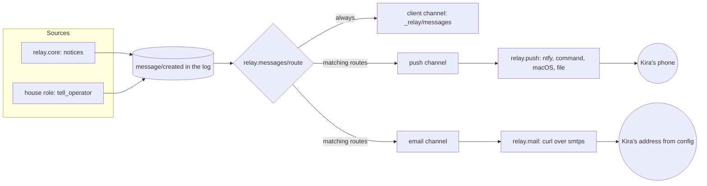
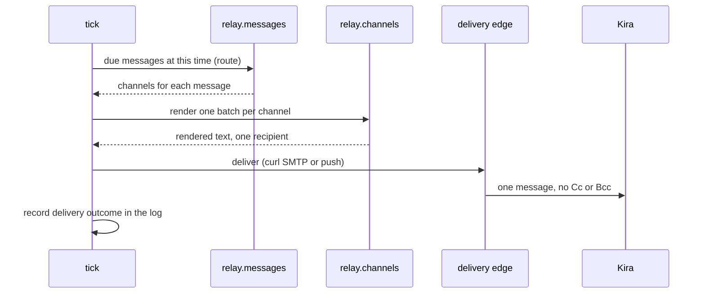
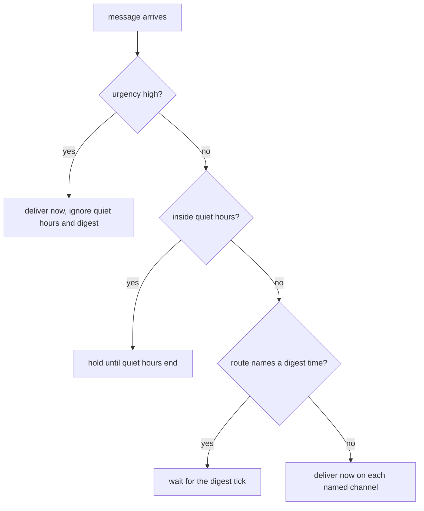

# B4: messages to Kira

What relay tells Kira is now one data model, a message (`relay.messages`),
recorded as `message/created`. Every old `notify` call in `relay.core`
makes one: memos to the operator, dead letters, outages, the budget,
changed tools, shown things, the runaway guard, public roles that cannot
run, and the morning brief (a `digest`, until B10 replaces it). A new
relay tool, `tell_operator` (class `edit`, house roles only), takes
content and urgency.

`:notify` is gone and refused with a pointer to `:messages`, which has
channels, routes, quiet hours and a digest time. Routing is
`relay.messages/route`, a pure function recorded into the event. The
channels are email (`relay.channels/email` and `relay.mail`, curl over
SMTP), push (`relay.channels/push` and `relay.push`, the old notifier's
ntfy, command, macOS and file kinds as `:via`) and the client
(`_relay/messages` and `_relay/messages/changed`). The tick delivers
what was held, stranded or failed, and sends what comes due together on
one channel as one.

Judgment calls, conservative where the plan was silent:

- `:messages` is optional. Without it every message shows in the client
  and goes nowhere else. `relay init` writes a push channel and a route.
- The agent's and Kira's addresses live on the email channel (`:from`,
  `:to`), not at the top of relay.edn. B8 reads Kira's address there.
- Plain `smtp://` is accepted only to 127.0.0.1, localhost or ::1; any
  other host needs `smtps://`. STARTTLS on 587 is not offered.
- A high-urgency message ignores both the quiet hours and the digest.
- `memo_send` to `operator` still works and becomes a note. The eval
  scenarios and graders count operator memos; removing it is B12's
  rewrite. resources/AGENTS.md now points roles at `tell_operator`.
- A push's `:link` is optional, a URL template with `{id}`: relay has no
  client URL scheme to assume.
- Old `notification/*` events fold into messages with no deliveries, so
  a push that was failing at deploy time is not retried.
- The wording of relay's own messages was rewritten so it names no role
  or tool class; it still names a tool or role id where Kira needs it to
  act (`relay retry <role>`, `set :digest to ...`).

## Fix round 1

- relay's own messages are made to fit (`relay.messages/fit`) instead of
  thrown out: items cut to 4000 characters, lists past 50 end with
  "…and N more.", sections past 12 likewise. A long memo, a long `said`
  or sixty shown paths had made `:wake/end` and `:tick` throw, and a
  tick that throws stops relay. Only tell_operator keeps the strict
  check, where a failure becomes a rejection. Item length is now
  counted in code points, as the subject's is.
- I2's property now draws nine accepted inputs in ten (one-line hostile
  subjects that keep CR, NEL, U+2028 and encoded words), always routes
  them to mail, and asserts each was accepted; the rest must be refused.
  A second property puts batches of 2-3 hostile messages through one
  email.
- `relay serve` installs its SIGTERM handler before it binds its socket.
  A SIGTERM that came as a client could first connect killed it with
  143 (the flaky serve-never-removes-what-is-not-its-socket).

## Commit stage

The phase commits in four steps, one concern each: the message model and
its channel adapters, the configuration and the tell_operator tool, the
callers moved from notify to messages, and the docs with this log. The
gate ran once on the final tree (`bb test`: 749 tests, 749 passed, 0
failed, 0 skipped). The commits were not gated one by one, so only the
tip is known to pass. The count is lower than the 914 in the baseline
table, which predates B1 and B2; nothing is skipped.

Nothing was integrated or pushed. The orchestrator rebases onto `main`,
re-runs the gate and moves the bookmark.

## Architecture of the message path

The house sends Kira mail, pushes and client updates through one data
model. Routing is a pure function of config, and each channel is an
adapter with a pure renderer and a thin delivery edge.

The tick is the only thing that delivers. It reads the log, asks the
route function what is due, and sends each channel's share as one
delivery.

Routing rules, in the order they apply:

The rules come from docs/messages.md. Two invariants guard the mail path:
I2 (one recipient, no Cc or Bcc, text/plain only, no model-chosen header
except the subject) and the rule that a model never chooses a medium or
an address.
